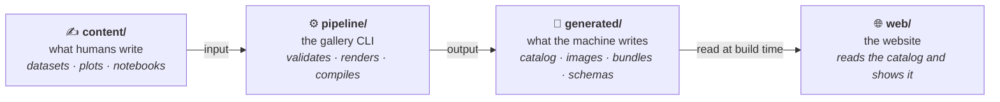

# Plot Gallery

**An open catalog of Python data visualizations where every plot is reproducible.** Each plot ships with its code, its dataset and a step-by-step notebook, and CI proves on every change that those three resources still reproduce the published image.

> **Status:** Phase 1 (foundation) of the [implementation plan](docs/specs/06-implementation-plan.md). The gallery itself is not published yet.

## How the repository works

The repository is split into four worlds. Each has one role, so you always know whether a file is meant to be edited.



| Folder | Role | Edit by hand? |
|--------|------|---------------|
| [`content/`](content/) | Plots (`plot.yaml`, `plot.py`, `notebook.ipynb`) and datasets | **Yes**, this is where content is created |
| [`pipeline/`](pipeline/) | The `gallery` CLI (Python) | When changing the tooling |
| [`generated/`](generated/) | Catalog, images, bundles, schemas | **Never**, `uv run gallery update` writes it |
| [`web/`](web/) | Static Next.js site, deployed on Vercel | When changing the site |
| [`docs/`](docs/) | Specifications and guides | Yes |

The whole system, with diagrams, is explained in [docs/specs/00-overview.md](docs/specs/00-overview.md).

## Quick start

Requirements: [uv](https://docs.astral.sh/uv/getting-started/installation/) (it installs Python 3.12 automatically) and [Node.js 24+](https://nodejs.org/).

```bash
# Python environment: plotting libraries + the gallery CLI
uv sync
uv run gallery --help
uv run pytest

# Website
cd web
npm install
npm run dev        # http://localhost:3000
```

## Tech stack

- **Content and pipeline:** Python 3.12, uv, pandas, NumPy, Matplotlib, seaborn, Pydantic, nbclient, Ruff, pytest
- **Website:** Next.js (App Router, static export), React, TypeScript, Tailwind CSS v4, shadcn/ui
- **Infrastructure:** GitHub Actions (quality and reproducibility checks), Vercel (hosting)

## Documentation

| Document | Content |
|----------|---------|
| [00 — The System at a Glance](docs/specs/00-overview.md) | The whole product in diagrams |
| [01 — Product Requirements](docs/specs/01-product-requirements.md) | Users, stories, acceptance criteria |
| [02 — Technical Architecture](docs/specs/02-technical-architecture.md) | Services, pipeline, reproducibility |
| [03 — Data Model](docs/specs/03-data-model.md) | Plot, dataset and catalog schemas |
| [04 — UI/UX Specification](docs/specs/04-ui-ux-spec.md) | Pages, components, visual system |
| [05 — Project Structure](docs/specs/05-project-structure.md) | Folders and conventions |
| [06 — Implementation Plan](docs/specs/06-implementation-plan.md) | Phases and testing strategy |

## Contributing

See [CONTRIBUTING.md](CONTRIBUTING.md).

## License

- Code: [MIT](LICENSE)
- Text and images: [CC BY 4.0](LICENSE-CONTENT)
- Datasets: each keeps its own license, declared in its `dataset.yaml`
