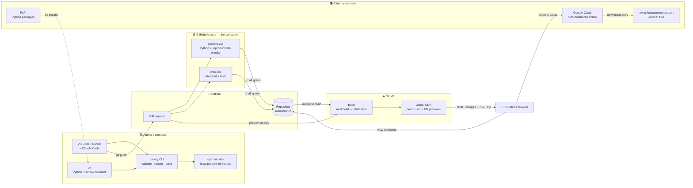
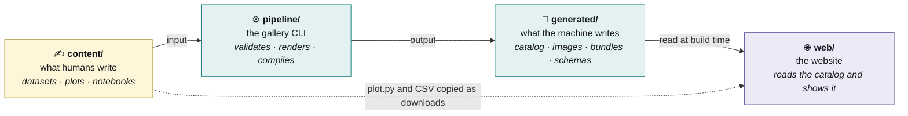
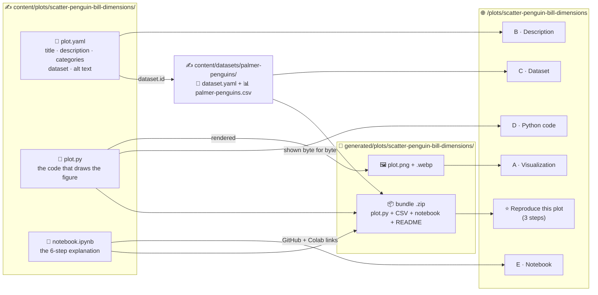
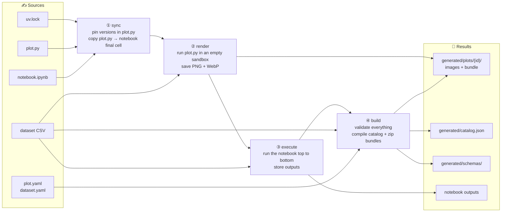
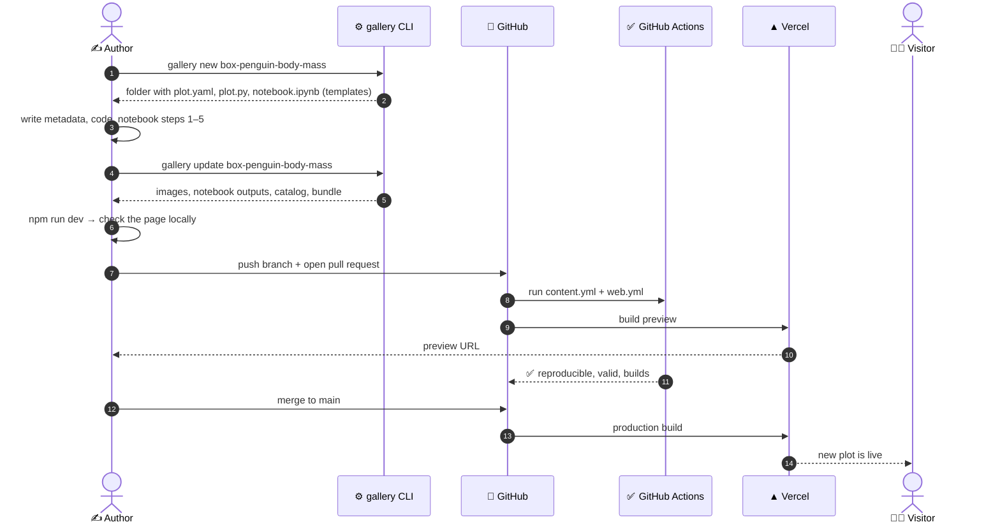
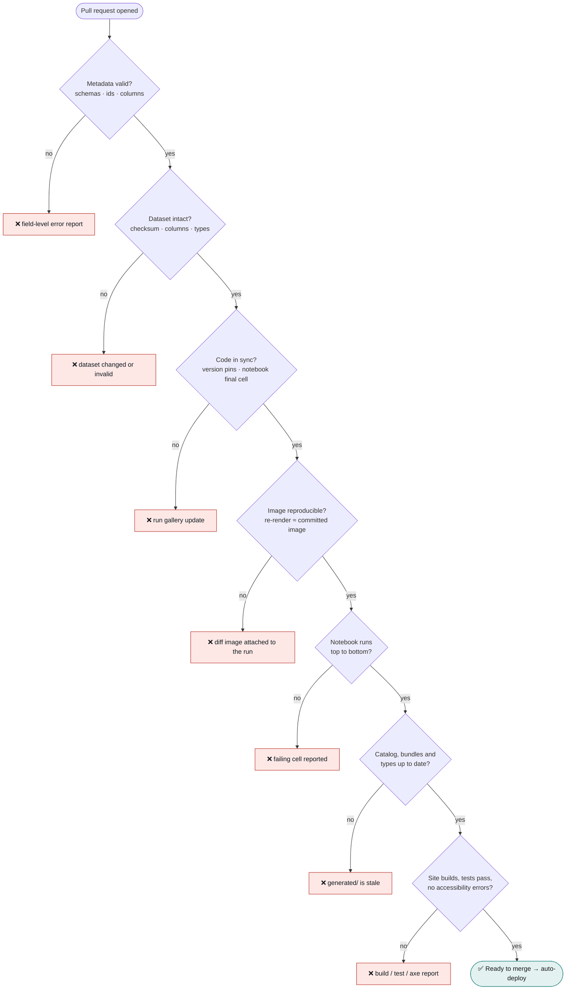
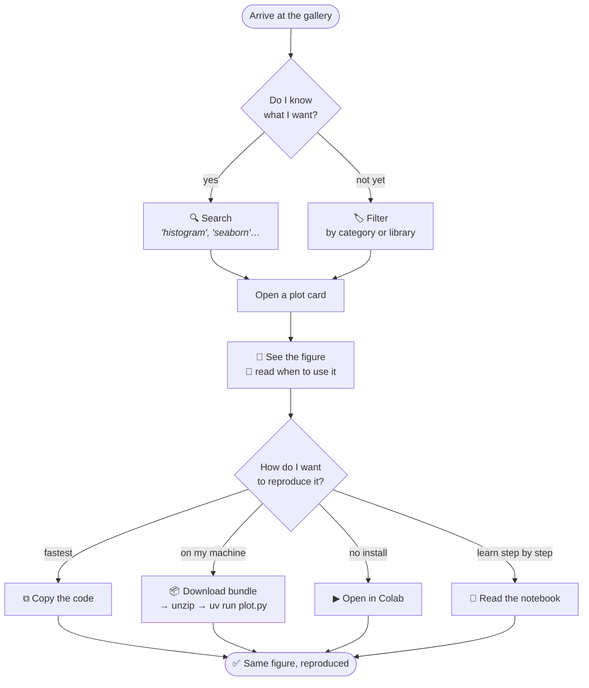
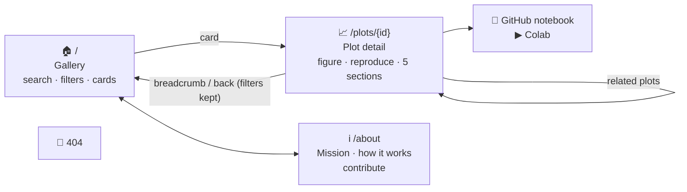
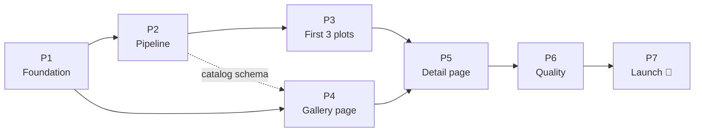

# 00 — The System at a Glance

> Status: Approved v1.0 · Last updated: 2026-10-18 · Index: [README](README.md)

This document explains the whole product **with pictures first**. Each diagram has a short caption, and the details live in documents 01–06.

> **Viewing the diagrams:** GitHub renders Mermaid natively. In VS Code or Cursor, install *Markdown Preview Mermaid Support* (`bierner.markdown-mermaid`) and open the Markdown preview (`Ctrl+Shift+V`).

---

## 1. What we are building, in one sentence

> A website where every Python plot comes with **the code, the data and a notebook** that reproduce it exactly, and where a robot checks that promise on every change.

---

## 2. The services, end to end

Who does what, from the author's keyboard to the visitor's screen.

| Service | Role | What runs there | Cost |
|---------|------|-----------------|------|
| **Author's computer** | Create and preview content | `uv`, the `gallery` CLI, Jupyter, `npm run dev` | — |
| **GitHub** | Source of truth; notebook rendering | git, PRs, notebook viewer | Free (public repo) |
| **GitHub Actions** | Prove every plot is still reproducible | Python checks, image comparison, notebook execution, site build, E2E tests | Free (public repo) |
| **Vercel** | Build and serve the site | `next build` (Node only, **no Python**), CDN | Free (Hobby) |
| **PyPI** | Package index | Used by `uv` locally, in CI, and for visitors running `uv run plot.py` | Free |
| **Google Colab** | Zero-install notebook execution for visitors | The plot's notebook | Free |

**Key idea:** Python only runs on the author's machine and in GitHub Actions. Visitors receive plain static files, which makes the site fast, cheap and safe.

---

## 3. The repository in four worlds

Each top-level folder has **one role**. If you know which world you are in, you know whether you should edit a file.

| World | Who writes it | Edit by hand? | Committed? |
|-------|---------------|---------------|------------|
| ✍️ `content/` | Authors | **Yes**, this is where content is created | Yes |
| ⚙️ `pipeline/` | Maintainers (tooling code) | Yes, when changing the tooling | Yes |
| 🤖 `generated/` | `uv run gallery update` | **Never** | Yes, and CI rejects any drift |
| 🌐 `web/` | Maintainers (frontend code) | Yes, when changing the site | Yes (except `public/assets/`, which is copied at build time) |
| 📘 `docs/` | Everyone | Yes | Yes |

The full tree is in [05 — Project Structure](05-project-structure.md).

---

## 4. Anatomy of a plot

Three files you write, plus one shared dataset, become one detail page.

| You write | It becomes |
|-----------|------------|
| `plot.yaml` | The card, the title, the description and the filters |
| `plot.py` | The image (rendered by CI), the code block, the download and the notebook's final cell |
| `notebook.ipynb` (steps 1–5) | The step-by-step lesson on GitHub and Colab |
| `dataset.yaml` + CSV (once, shared) | The dataset section, the preview table and the download |

---

## 5. The pipeline: from sources to site

`uv run gallery update` runs four steps in order. `uv run gallery check` runs the same logic **without writing anything** and fails on any difference. That is what CI runs.

The **sandbox** is a temporary empty folder that contains only `plot.py` and its CSV. If the code secretly depends on anything else (another file, the internet, your personal matplotlib settings), it fails there instead of failing for a visitor.

---

## 6. The life of a plot: from idea to production

---

## 7. The safety net: what CI guarantees

Every pull request has to pass every gate. A ❌ blocks the merge, so broken content never reaches visitors.

---

## 8. The visitor's journey

The UX has a single goal: **go from "I need a chart" to "I have it running" in as few steps as possible.**

---

## 9. Pages at a glance

Wireframes and the visual system are in [04 — UI/UX](04-ui-ux-spec.md).

---

## 10. The build plan

Details, tasks and exit criteria are in [06 — Implementation Plan](06-implementation-plan.md).

---

## 11. Where to read more

| If you want to know… | Read |
|----------------------|------|
| Why the product exists, user stories, acceptance criteria | [01 — Product Requirements](01-product-requirements.md) |
| How the system works and why it was designed that way | [02 — Technical Architecture](02-technical-architecture.md) |
| What every file contains and how it is validated | [03 — Data Model](03-data-model.md) |
| How it looks and behaves | [04 — UI/UX Specification](04-ui-ux-spec.md) |
| Where each file lives | [05 — Project Structure](05-project-structure.md) |
| In what order we build it | [06 — Implementation Plan](06-implementation-plan.md) |
