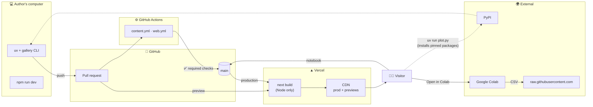
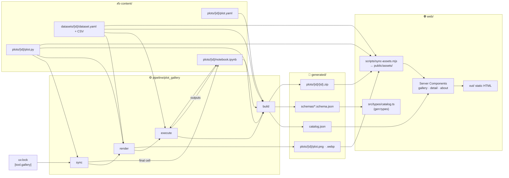

# 02 — Technical Architecture

> Status: Approved v1.0 · Last updated: 2026-10-18 · Index: [README](README.md) · Visual summary: [00](00-overview.md)

## 1. Architectural principles

1. **Static at runtime, computed at build time.** Python runs only on a contributor's machine and in CI. The website is pre-rendered HTML, CSS and images.
2. **One folder, one role.** `content/` is written by humans, `pipeline/` is the tool, `generated/` is written by the machine, `web/` is the site.
3. **One source of truth per concern.** Plot code → `plot.py`. Dependency versions → `uv.lock`. Schemas → Pydantic models. Data → the versioned CSV. Repository coordinates → `[tool.gallery]`.
4. **Generated means verified.** Everything in `generated/` can be reproduced from the sources, and CI fails on drift.
5. **Boring and small.** Use the fewest tools that meet the requirements, and only well-maintained mainstream ones.
6. **Content is data.** Adding a plot never requires frontend changes.

## 2. Technology stack

### 2.1 Python (content and pipeline)

| Concern | Choice | Rationale |
|---------|--------|-----------|
| Runtime | Python 3.12 (`.python-version`) | Required by the brief, supported until 2028 |
| Environment and dependencies | **uv** (single project, `uv.lock`) | Fast, reproducible lockfile; `uv run`; PEP 723 for standalone `plot.py` |
| Build backend | `uv_build` (`module-root = "pipeline"`) | Native to uv; packages the CLI straight from `pipeline/` |
| Plotting | matplotlib, seaborn, numpy, pandas | MVP content. Plotly is added with the first interactive plot (D-06). |
| Schema validation | **Pydantic v2** | Typed models and clear errors. It exports the JSON Schema used for YAML autocompletion and the TypeScript types. |
| YAML | PyYAML (`safe_load`) | Readable, commentable metadata |
| Notebook execution | **nbclient** + nbformat + ipykernel | The minimal official Jupyter execution stack |
| Images | Pillow (comes with matplotlib) | WebP thumbnails |
| Image comparison | `matplotlib.testing.compare.compare_images` | RMS comparison with tolerance; already installed |
| Bundles | `zipfile` (stdlib) | Deterministic zip files, with no extra dependency |
| CLI | `argparse` (stdlib) | Seven subcommands do not justify Typer or Click |
| Lint and format | **Ruff** (`quote-style = 'single'`) | One tool; single quotes for strings, triple double quotes for docstrings |
| Tests | pytest | Standard |
| Authoring | JupyterLab (`notebooks` dependency group) | Only for those who edit notebooks |

### 2.2 Frontend

| Concern | Choice | Rationale |
|---------|--------|-----------|
| Framework | **Next.js (App Router), latest stable** at implementation time, React 19, TypeScript strict | Server Components read content at build time without shipping it to the client |
| Output mode | **Static export** (`output: 'export'`) (D-05) | No server runtime; served from the Vercel CDN |
| Styling | **Tailwind CSS v4** + CSS-variable tokens | Consistent and themeable |
| UI primitives | **shadcn/ui** (copied in, built on Radix): Button, Badge, Input, Dialog, Tooltip, DropdownMenu, Separator | Accessible components we own; only the ones we use are added |
| Syntax highlighting | **Shiki** at build time, dual light/dark theme | Highlighted HTML with no client JS |
| Theme | **next-themes** | No flash of the wrong theme; System/Light/Dark |
| Icons | lucide-react | Tree-shaken; includes chart glyphs for categories |
| Fonts | Geist Sans + Geist Mono via `next/font` | Self-hosted, no layout shift |
| Search | A pure custom function | Fewer than ~500 plots does not justify Fuse.js |
| Types | `json-schema-to-typescript` (dev) | TypeScript types generated from the catalog schema |
| Tests | Vitest; Playwright + @axe-core/playwright (D-11) | |
| Runtime | Node.js 24 LTS, npm (D-09) | |

### 2.3 Changes to the brief's stack

| Change | Why |
|--------|-----|
| **Plotly deferred** | No MVP plot uses it. It needs Kaleido + Chrome in CI and about 1 MB of plotly.js on the client. It comes back with the first interactive plot. |
| **Added:** Pydantic, PyYAML, nbclient, Shiki, next-themes | Each solves a concrete requirement with the smallest mainstream option |
| **Jupyter** narrowed to nbclient (CI) + JupyterLab (authoring group) | CI does not need a full Jupyter install |

## 3. Services architecture



| Service | Responsibility | Never does |
|---------|----------------|------------|
| Author's machine | Authoring, `gallery update`, local preview | — |
| GitHub | Source of truth, PRs, notebook rendering, raw files for Colab | — |
| GitHub Actions | Reproducibility and quality gates (`gallery check`, site build, tests) | Write to the repository |
| Vercel | Build the static site from `main` and from PRs, then serve it from its CDN | Run Python |
| PyPI | Packages for uv (authors, CI, visitors) | — |
| Google Colab | Run a notebook for visitors without any install | — |

## 4. Components and data flow



| Component | Responsibility | Does **not** |
|-----------|----------------|--------------|
| `content/` | Metadata, canonical code, narrative notebook, datasets | Contain machine-generated files (the notebook's outputs and final cell are the only exception) |
| `pipeline/plot_gallery` | Validate, sync, render, execute, compile, bundle, check | Know anything about React or HTML |
| `generated/catalog.json` | The **only** contract between Python and the web: validated, denormalized, deterministic | Contain binaries or absolute site URLs |
| `web/scripts/sync-assets.mjs` | Copy images, bundles, `plot.py` and CSVs into `web/public/assets/` (gitignored) before `dev` and `build` | Transform anything |
| `web/src/lib/catalog.ts` | Read `../generated/catalog.json` at build time (server-only, `fs`) and expose typed helpers | Validate (the pipeline already did) |
| Next.js pages | Present the catalog | Contain business logic |

## 5. The pipeline

### 5.1 Commands

| Command | Writes | Purpose |
|---------|--------|---------|
| `gallery new <plot-id>` | `content/plots/<plot-id>/*` | Scaffold from `pipeline/templates/plot/` |
| `gallery sync [ids…]` | `plot.py` header; notebook `data` and `final` cells | Pin dependencies from `uv.lock`; copy `plot.py` into the final cell |
| `gallery render [ids…]` | `generated/plots/<id>/plot.png`, `.webp` | Run `plot.py` in the sandbox |
| `gallery execute [ids…]` | `notebook.ipynb` outputs | Run the notebook in the sandbox |
| `gallery build` | `generated/catalog.json`, `generated/schemas/`, `generated/plots/<id>/<id>.zip` | Validate everything; compile the catalog and bundles |
| `gallery update [ids…]` | all of the above | `sync → render → execute → build` (**the everyday command**) |
| `gallery check` | **nothing** | All validations + drift checks. This is what CI runs. Use `--skip-notebooks` for a fast local loop. |

Without ids, commands apply to every plot. Exit code 0 means OK, 1 means validation or drift errors, and 2 means a usage error.

### 5.2 Render sandbox

1. Create a temporary directory containing **only** `plot.py` and the dataset file, under the file name the code uses.
2. Start a subprocess with the project interpreter, `cwd` = the sandbox, and the environment `MPLBACKEND=Agg`, `MPLCONFIGDIR=<empty temp dir>` (which ignores any personal `matplotlibrc`), `PYTHONHASHSEED=0` and `SOURCE_DATE_EPOCH=0`.
3. A harness imports `plot.py` with `runpy.run_path(..., run_name='gallery')`, so the `__main__` block does not run. It then calls `main()`, checks that the result is a `Figure` of 8×6 in, and saves it with `fig.savefig('plot.png', dpi=200, metadata={'Software': None})`.
4. The PNG (1600×1200) goes to `generated/plots/<id>/`, and Pillow writes `plot-1600.webp` and `plot-800.webp`.
5. A timeout (default 60 s), any exception, any extra file written, or a wrong figure size fails the run.

### 5.3 Notebook execution

The notebook and dataset are copied into a sandbox and executed with `nbclient` (kernel `python3`, a 120 s timeout per cell, the same environment variables). On success, the executed notebook is written back (so GitHub shows the outputs), with volatile metadata stripped to keep diffs small.

### 5.4 Reproduction bundle

`gallery build` writes `generated/plots/<id>/<id>.zip`:

```text
scatter-penguin-bill-dimensions.zip
└── scatter-penguin-bill-dimensions/
    ├── README.md               # generated: title, 3 steps to run, links, license, citation
    ├── plot.py                 # canonical code (with PEP 723 header)
    ├── palmer-penguins.csv     # dataset
    └── notebook.ipynb          # the step-by-step notebook
```

The zip is deterministic: entries are sorted, timestamps are fixed to 1980-01-01, and permissions are fixed. Identical inputs therefore produce identical bytes, and the drift check works on it. The visitor's flow is: download → unzip → `uv run plot.py`.

## 6. Reproducibility

### 6.1 The reproducibility contract

| # | Rule | Enforced by |
|---|------|-------------|
| R-1 | `plot.py` runs with only itself and its dataset in the working directory | Render sandbox |
| R-2 | `plot.py` defines `main() -> Figure` and an `if __name__ == '__main__':` block calling `main()` and `plt.show()` | Harness + AST check |
| R-3 | It starts with a PEP 723 header pinned (`==`) to the versions in `uv.lock` | `gallery check` (sync drift) |
| R-4 | Any randomness is seeded; nothing comes from the network or the clock | Image comparison + review |
| R-5 | The committed image matches a fresh render within tolerance | `gallery check` (image comparison) |
| R-6 | The notebook's final cell equals `plot.py` (minus the header), and the notebook runs top to bottom | `gallery check` (sync + execution) |
| R-7 | The dataset matches its SHA-256 and declared columns; `required_columns` exist | `gallery check` (validation) |
| R-8 | Everything in `generated/` equals a fresh build (catalog, schemas, bundles) | `gallery check` (drift) |

### 6.2 Dependencies with uv

- **One project, one lock.** The root `pyproject.toml` declares the plotting libraries and the pipeline dependencies, plus the groups `dev` (pytest, ruff) and `notebooks` (jupyterlab).
- **Standalone runs.** Each `plot.py` has a PEP 723 header (`# /// script`) with only the packages it imports, pinned to the locked versions and written by `gallery sync`. `uv run plot.py` builds a matching environment on any machine.
- **Upgrades** are explicit: `uv lock --upgrade-package seaborn` → `gallery update` → review the image changes in the PR → merge. Dependabot (P7) proposes them.
- CI runs `uv sync --locked`, so a stale lockfile fails.

### 6.3 Dataset versioning

- CSVs are vendored in git (≤ 5 MB), with the SHA-256, source, license, upstream version and retrieval date in `dataset.yaml`.
- Any change to the file bumps `version` and updates the checksum. The catalog's `used_by` list shows which plots it affects.
- Breaking changes (columns renamed or removed) create a new `dataset-id` (`palmer-penguins-v2`).

### 6.4 Image comparison and determinism

- `compare_images(expected, actual, tol)` measures RMS on a 0–255 scale. The tolerance starts at `2.0` and is calibrated in P2 across Windows and Ubuntu.
- Determinism measures: Agg backend, isolated `MPLCONFIGDIR`, matplotlib's bundled DejaVu Sans font, fixed dpi and size, stripped PNG metadata, fixed seeds.
- On failure, CI uploads the expected/actual/diff images as a workflow artifact.

### 6.5 Configuration (`[tool.gallery]` in `pyproject.toml`)

```toml
[tool.gallery]
repo_owner = "neisserale"
repo_name = "python-plot-gallery"
repo_branch = "main"
dpi = 200
figure_size = [8, 6]
image_tolerance = 2.0
render_timeout_s = 60
cell_timeout_s = 120
max_dataset_mb = 5
```

The repository coordinates are copied into `catalog.json` (`repository`), so the web builds GitHub, Colab and raw-file links from the same source. The only environment variable the site needs is `NEXT_PUBLIC_SITE_URL` (for canonical URLs and the sitemap).

## 7. GitHub and Vercel integration

### 7.1 GitHub Actions

**`content.yml`.** Triggered on PRs and pushes to `main` that touch `content/**`, `pipeline/**`, `generated/**`, `pyproject.toml` or `uv.lock`.

```text
jobs:
  quality:  setup-uv → uv sync --locked → ruff check → ruff format --check → pytest
  content:  setup-uv → uv sync --locked → uv run gallery check
            (on failure: upload expected / actual / diff images)
```

**`web.yml`.** Triggered on PRs and pushes to `main` that touch `web/**`, `generated/**` or `content/**`.

```text
jobs:
  web:  setup-node 24 (npm cache) → npm ci
        → npm run gen:types && git diff --exit-code src/types   (type drift)
        → npm run lint → npm run typecheck → npm run test
        → npm run build (static export)
        → playwright install chromium → npm run test:e2e (serves out/)
```

Branch protection on `main` requires `quality`, `content` and `web`.

### 7.2 Vercel

| Setting | Value |
|---------|-------|
| Framework preset | Next.js |
| Root directory | `web` |
| Include files outside root directory | **Enabled** (the build reads `../generated` and `../content`) |
| Install / Build | `npm ci` / `npm run build` (`prebuild` runs `sync-assets`) |
| Node.js | 24.x |
| Production branch | `main`; previews for every PR |
| Environment variables | `NEXT_PUBLIC_SITE_URL` |
| Headers | `web/vercel.json` (CSP, security headers, long cache for `/assets/*` and `/_next/static/*`) |

### 7.3 External links (built in `web/src/lib/urls.ts` from `catalog.repository`)

| Link | Pattern |
|------|---------|
| Notebook on GitHub | `https://github.com/{owner}/{repo}/blob/{branch}/content/plots/{id}/notebook.ipynb` |
| Open in Colab | `https://colab.research.google.com/github/{owner}/{repo}/blob/{branch}/content/plots/{id}/notebook.ipynb` |
| Raw dataset (Colab data cell) | `https://raw.githubusercontent.com/{owner}/{repo}/{branch}/content/datasets/{dataset-id}/{file}` |
| Install uv | `https://docs.astral.sh/uv/getting-started/installation/` |

## 8. Decisions and trade-offs

| ADR | Decision | Alternatives | Trade-off accepted |
|-----|----------|--------------|--------------------|
| ADR-01 | Static site, no backend or database | SSR, a Python API | Content updates need a commit and deploy |
| ADR-02 | `plot.py` canonical; the notebook's final cell is generated | Notebook as the source; Jupytext pairing | Notebook steps 1–5 are written separately, on purpose, because they teach |
| ADR-03 | Generated artifacts committed in `generated/` + drift check | A CI bot commits them; generation on Vercel | A slightly larger repo; in exchange, a Python-free Vercel and image diffs visible in PRs |
| ADR-04 | Visual comparison with tolerance | Exact hashes; SVG diff | Could miss changes below the tolerance; robust across operating systems |
| ADR-05 | Pydantic → JSON Schema → TypeScript | Separate Zod + Pydantic | One codegen step, one schema |
| ADR-06 | Static export | Default Next.js on Vercel | No `next/image` optimization (thumbnails are pre-optimized); headers in `vercel.json` |
| ADR-07 | Shiki at build time | Client-side highlighters | Slower builds (negligible) |
| ADR-08 | Vendored CSV datasets | Remote URLs, DVC, Git LFS | Limited to small datasets |
| ADR-09 | Plotly deferred | Plotly in the MVP | Fewer chart types at launch |
| ADR-10 | A single uv project | One environment per plot | Shared library versions across plots |
| ADR-11 | **Four worlds** (`content`, `pipeline`, `generated`, `web`) | Flat root with `src/` and `tests/`; generated files spread across three places | `pipeline/` needs one setting in `uv_build` (`module-root`) |
| ADR-12 | **Zip bundle per plot** | Separate downloads only | About 20 KB per plot of committed binary; reproducing becomes a 3-step task |

## 9. Future extensions (designed for, not built)

- **Interactive plots:** `render.kind: interactive`. `main()` returns a Plotly figure, the pipeline saves `figure.json` plus a static thumbnail, and the page lazy-loads `plotly.js-basic-dist-min`.
- **Dark image variants:** a second render with a dark style, switched with `<picture>` and `prefers-color-scheme`.
- **Category landing pages** (`/categories/<id>`) for SEO.
- **A separate search index** once the catalog has more than about 300 plots.
- **Privacy-friendly analytics** (Vercel Web Analytics), as an opt-in decision.
