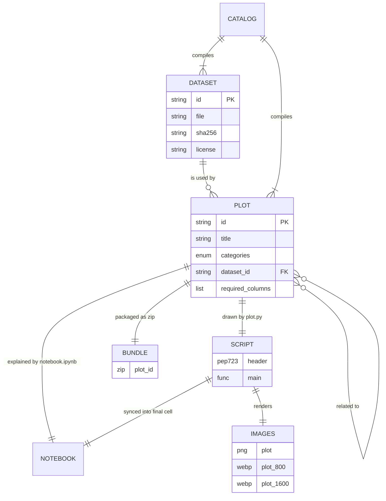
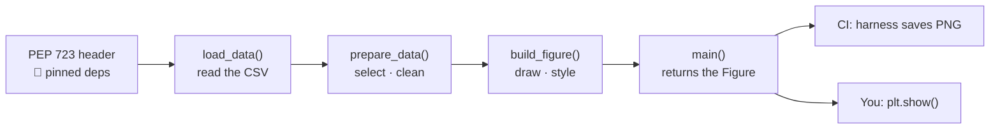
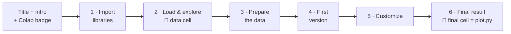
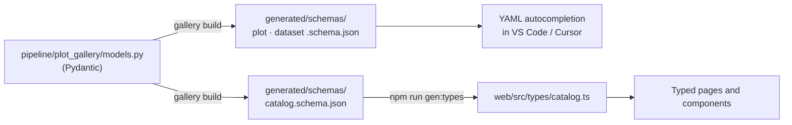

# 03 — Data Model

> Status: Approved v1.0 · Last updated: 2026-10-18 · Index: [README](README.md) · Visual summary: [00](00-overview.md)

## 1. Overview

Authors write three kinds of files: **plot metadata, plot code and notebooks, and datasets**. The pipeline turns them into images, bundles and one **catalog**, which is the only file the website reads.



| Entity | Location | Written by | Key |
|--------|----------|------------|-----|
| Dataset | `content/datasets/<dataset-id>/dataset.yaml` + `<dataset-id>.csv` | ✍️ Author | `dataset-id` = folder name |
| Plot | `content/plots/<plot-id>/plot.yaml` | ✍️ Author | `plot-id` = folder name |
| Script | `content/plots/<plot-id>/plot.py` | ✍️ Author (🤖 PEP 723 header) | 1:1 with plot |
| Notebook | `content/plots/<plot-id>/notebook.ipynb` | ✍️ Author (🤖 `data` cell, `final` cell, outputs) | 1:1 with plot |
| Images | `generated/plots/<plot-id>/plot.png`, `plot-800.webp`, `plot-1600.webp` | 🤖 `gallery render` | 1:1 with plot |
| Bundle | `generated/plots/<plot-id>/<plot-id>.zip` | 🤖 `gallery build` | 1:1 with plot |
| Catalog | `generated/catalog.json` | 🤖 `gallery build` | — |
| Schemas | `generated/schemas/{plot,dataset,catalog}.schema.json` | 🤖 `gallery build` | — |

Files are linked **by convention (the folder name = the id), not by paths in metadata**. Metadata refers to other entities only by id (`dataset.id`, `related`).

## 2. Identifiers

| Rule | Value |
|------|-------|
| Format | kebab-case, `^[a-z0-9]+(-[a-z0-9]+)*$`, 3–64 characters |
| Plot id pattern | `<chart-type>-<subject>`, e.g. `scatter-penguin-bill-dimensions` (folders then sort by chart type) |
| Dataset id pattern | `<subject>[-vN]`, e.g. `palmer-penguins` |
| Stability | Ids are part of URLs and never change once published. A rename needs a redirect in `vercel.json`. |
| Consistency | The `id` in YAML must equal the folder name (validated). |

## 3. Plot metadata (`plot.yaml`)

### 3.1 Fields

| Field | Type | Req. | Rules / notes |
|-------|------|------|---------------|
| `schema_version` | int | ✔ | `1` |
| `id` | string | ✔ | §2; equals the folder name |
| `title` | string | ✔ | 3–80 characters, sentence case. Card title and H1. |
| `summary` | string | ✔ | 20–160 characters. Card text and meta description. |
| `chart_type` | string | ✔ | e.g. `Scatter plot`, `Box plot`, `Histogram`. 2–40 characters. |
| `categories` | list[enum] | ✔ | 1–3 unique values from `distribution`, `comparison`, `relationship`, `composition`, `time-series`, `statistical`, `machine-learning`. The first one is primary (shown in the breadcrumb). |
| `primary_library` | enum | ✔ | Must be one of the libraries detected in `plot.py` (§5.2) |
| `tags` | list[string] | – | 0–10 kebab-case tags |
| `difficulty` | enum | ✔ | `beginner`, `intermediate`, `advanced` |
| `description.what` | string | ✔ | 40–600 characters |
| `description.when_to_use` | list[string] | ✔ | 2–5 items |
| `description.applications` | list[string] | ✔ | 2–5 items |
| `description.caveats` | list[string] | – | 0–5 items |
| `dataset.id` | string | ✔ | Must exist in `content/datasets/` |
| `dataset.required_columns` | list[string] | ✔ | ≥ 1; each must be a declared dataset column |
| `image.alt` | string | ✔ | 40–400 characters. Describes the content and the main pattern. |
| `render.kind` | enum | – | `static` (default). `interactive` is reserved and **rejected** in v1. |
| `related` | list[string] | – | 0–3 existing plot ids, not including itself |
| `featured` | bool | – | Default `false` |
| `authors` | list[string] | ✔ | GitHub usernames, ≥ 1 |
| `created` | date | ✔ | ISO `YYYY-MM-DD` |
| `updated` | date | – | ≥ `created`; defaults to `created` |

Text is **plain text**; backtick spans are rendered as inline `<code>`, and nothing else is interpreted.

### 3.2 Example

```yaml
# yaml-language-server: $schema=../../../generated/schemas/plot.schema.json
schema_version: 1
id: scatter-penguin-bill-dimensions
title: Penguin bill dimensions by species
summary: Bill length against bill depth for three penguin species, revealing clusters a single variable would hide.
chart_type: Scatter plot
categories: [relationship]
primary_library: seaborn
tags: [scatter, clusters, grouping, hue, simpsons-paradox]
difficulty: beginner

description:
  what: >-
    Each point is one penguin, positioned by its bill length (x) and bill depth (y)
    and colored by species. It shows how two numeric variables relate and whether
    groups form distinct clusters.
  when_to_use:
    - You want to see the relationship between two numeric variables.
    - You suspect subgroups behave differently and want to compare them visually.
    - You need to spot clusters, outliers or non-linear patterns before modeling.
  applications:
    - Exploratory data analysis before regression or classification.
    - Checking feature separability for a classifier.
    - Detecting Simpson's paradox across groups.
  caveats:
    - With thousands of points, overplotting hides density; use transparency or a hexbin plot.
    - Correlation in a scatter plot does not imply causation.

dataset:
  id: palmer-penguins
  required_columns: [species, bill_length_mm, bill_depth_mm]

image:
  alt: >-
    Scatter plot of bill depth versus bill length for Adelie, Chinstrap and Gentoo
    penguins. The three species form separate clusters: Adelie have short, deep bills,
    Gentoo long, shallow bills and Chinstrap long, deep bills.

related: [box-penguin-body-mass, histogram-penguin-flipper-length]
featured: true
authors: [neisserale]
created: 2026-10-18
```

The first line gives autocompletion and validation in VS Code and Cursor (Red Hat YAML extension).

## 4. Dataset metadata (`dataset.yaml`)

### 4.1 Fields

| Field | Type | Req. | Rules / notes |
|-------|------|------|---------------|
| `schema_version` | int | ✔ | `1` |
| `id` | string | ✔ | Equals the folder name |
| `name` | string | ✔ | Display name |
| `description` | string | ✔ | 40–600 characters |
| `file` | string | ✔ | Must be `<dataset-id>.csv`. **This exact name is used by `plot.py`, the bundle and the download.** |
| `format` | enum | ✔ | `csv`: UTF-8, comma-separated, header row, empty cell = missing |
| `sha256` | string | ✔ | Recomputed in CI |
| `version` | string | ✔ | Version of *our* copy (`1.0.0`); bumped on every change |
| `source.name` / `source.url` | string / url | ✔ | Original publisher and landing page |
| `source.upstream_version` | string | – | Upstream release |
| `source.retrieved` | date | ✔ | Download date |
| `license.id` / `license.url` | SPDX / url | ✔ | Allowed: `CC0-1.0`, `CC-BY-4.0`, `PDDL-1.0`, `ODC-By-1.0`, `MIT` |
| `citation` | string | ✔ | Recommended citation |
| `columns[]` | list | ✔ | In the same order as the CSV header |
| `columns[].name` | string | ✔ | Matches the header |
| `columns[].type` | enum | ✔ | `integer`, `float`, `string`, `categorical`, `boolean`, `date`, `datetime` (checked) |
| `columns[].description` | string | ✔ | |
| `columns[].unit` | string | – | `mm`, `g`… |
| `columns[].categories` | list | – | Allowed values for `categorical` (checked) |
| `columns[].nullable` | bool | – | Default `false`; missing values fail unless `true` |

Derived by the pipeline (never written by hand): `rows`, `size_bytes`, `missing` per column, `preview` (the first 10 rows), `used_by`.

### 4.2 Example

```yaml
# yaml-language-server: $schema=../../../generated/schemas/dataset.schema.json
schema_version: 1
id: palmer-penguins
name: Palmer Penguins
description: >-
  Size measurements for 344 adult foraging penguins of three species observed on
  three islands in the Palmer Archipelago, Antarctica, between 2007 and 2009.
file: palmer-penguins.csv
format: csv
sha256: <computed at implementation>
version: 1.0.0
source:
  name: palmerpenguins (R package) by Allison Horst, Alison Hill and Kristen Gorman
  url: https://allisonhorst.github.io/palmerpenguins/
  upstream_version: 0.1.1
  retrieved: 2026-10-18
license:
  id: CC0-1.0
  url: https://creativecommons.org/publicdomain/zero/1.0/
citation: >-
  Horst AM, Hill AP, Gorman KB (2020). palmerpenguins: Palmer Archipelago (Antarctica)
  penguin data. R package version 0.1.0. doi:10.5281/zenodo.3960218
columns:
  - { name: species, type: categorical, categories: [Adelie, Chinstrap, Gentoo], description: Penguin species }
  - { name: island, type: categorical, categories: [Biscoe, Dream, Torgersen], description: Island in the Palmer Archipelago }
  - { name: bill_length_mm, type: float, unit: mm, nullable: true, description: Bill (culmen) length }
  - { name: bill_depth_mm, type: float, unit: mm, nullable: true, description: Bill (culmen) depth }
  - { name: flipper_length_mm, type: integer, unit: mm, nullable: true, description: Flipper length }
  - { name: body_mass_g, type: integer, unit: g, nullable: true, description: Body mass }
  - { name: sex, type: categorical, categories: [female, male], nullable: true, description: Penguin sex }
  - { name: year, type: integer, description: Study year (2007–2009) }
```

## 5. Canonical script (`plot.py`)

### 5.1 Structure contract

The recommended structure mirrors notebook steps 2–5: **load → prepare → build**.



```python
# /// script
# requires-python = ">=3.12"
# dependencies = [
#     "matplotlib==3.10.7",
#     "pandas==2.3.3",
#     "seaborn==0.13.2",
# ]
# ///
"""Scatter plot of penguin bill dimensions, colored by species.

Run it next to `palmer-penguins.csv` with:  uv run plot.py
"""

import matplotlib.pyplot as plt
import pandas as pd
import seaborn as sns
from matplotlib.figure import Figure

DATA_PATH = 'palmer-penguins.csv'


def load_data(path: str = DATA_PATH) -> pd.DataFrame:
    """Load the Palmer Penguins dataset from a local CSV file."""
    return pd.read_csv(path)


def prepare_data(df: pd.DataFrame) -> pd.DataFrame:
    """Keep the columns used by the plot and drop rows with missing values."""
    columns = ['species', 'bill_length_mm', 'bill_depth_mm']
    return df[columns].dropna()


def build_figure(df: pd.DataFrame) -> Figure:
    """Draw bill length against bill depth with one color per species."""
    fig, ax = plt.subplots(figsize=(8, 6), layout='constrained')
    sns.scatterplot(
        data=df,
        x='bill_length_mm',
        y='bill_depth_mm',
        hue='species',
        palette='colorblind',
        s=50,
        alpha=0.85,
        ax=ax,
    )
    # Descriptive labels with units make the plot readable without the dataset docs
    ax.set(
        title='Bill dimensions of Palmer penguins',
        xlabel='Bill length (mm)',
        ylabel='Bill depth (mm)',
    )
    ax.legend(title='Species', frameon=False)
    sns.despine(fig)
    return fig


def main() -> Figure:
    """Build the final figure from the raw dataset."""
    return build_figure(prepare_data(load_data()))


if __name__ == '__main__':
    main()
    plt.show()
```

*(The versions shown are illustrative. `gallery sync` writes the real ones from `uv.lock`. The header uses double quotes because TOML requires them.)*

| Rule | Check |
|------|-------|
| PEP 723 header present; `dependencies` = detected imports pinned to `uv.lock` | `gallery check` (sync) |
| Module docstring present | AST |
| `DATA_PATH` is a module-level string equal to the dataset's `file` | AST |
| `main()` returns a `matplotlib.figure.Figure` | Harness |
| `if __name__ == '__main__':` block present | AST |
| Figure size 8×6 in (1600×1200 px at 200 dpi) | Harness |
| Imports limited to the standard library plus `matplotlib`, `seaborn`, `numpy`, `pandas` (`scipy` and `scikit-learn` when first needed) | AST |
| Ruff-clean | CI |
| No network access or file writes; deterministic | Sandbox + image comparison |

### 5.2 Derived library information

The pipeline parses the imports (`ast`) and maps modules to packages (`sklearn` → scikit-learn, etc.). This produces:

- `libraries` in the catalog (filters and badges), with versions from `uv.lock`;
- the PEP 723 dependency list;
- the validation `primary_library ∈ libraries`.

The metadata therefore can never claim a library the code does not use.

## 6. Notebook (`notebook.ipynb`)

### 6.1 Required structure



| # | Exact H2 heading | Content |
|---|------------------|---------|
| — | H1 = `title` + intro | One paragraph, a Colab badge, a link to the gallery page, the tested library versions |
| 1 | `## 1. Import libraries` | Imports, with a sentence on what each library does |
| 2 | `## 2. Load and explore the dataset` | 🤖 **data cell** (tag `data`), then `head()`, `info()`, `describe()`, missing values |
| 3 | `## 3. Prepare the data` | Selection and cleaning, with the reason for each step |
| 4 | `## 4. Build a first version of the plot` | The minimal plot with defaults |
| 5 | `## 5. Customize the plot` | Incremental improvements, explained |
| 6 | `## 6. Final result` | A short intro plus 🤖 **one cell tagged `final`** |

**Data cell** (generated by `gallery sync` from configuration). It works locally, in the bundle and in Colab:

```python
from pathlib import Path
from urllib.request import urlretrieve

DATA_PATH = 'palmer-penguins.csv'
DATA_URL = 'https://raw.githubusercontent.com/neisserale/python-plot-gallery/main/content/datasets/palmer-penguins/palmer-penguins.csv'

# Download the dataset only when it is not already next to the notebook (e.g. in Colab)
if not Path(DATA_PATH).exists():
    urlretrieve(DATA_URL, DATA_PATH)
```

**Final cell:** the content of `plot.py` without the PEP 723 header. In a Jupyter kernel `__name__ == '__main__'`, so the cell draws the final figure inline, identical to the gallery image.

### 6.2 Validation

- Headings present and in order; exactly one `data` cell and one `final` cell.
- The `data` and `final` cells equal their expected text (sync check).
- The notebook runs in the sandbox without errors.
- Kernel spec `python3`; volatile metadata stripped.

## 7. Generated outputs per plot (`generated/plots/<plot-id>/`)

| File | Spec | Used for |
|------|------|----------|
| `plot.png` | 1600×1200 RGB, `savefig(dpi=200)` | Comparison reference; full-resolution view |
| `plot-1600.webp` | 1600 px wide, quality 90 | Detail page (2×) |
| `plot-800.webp` | 800 px wide, quality 85, ≤ 80 KB | Cards, detail page (1×), Open Graph |
| `<plot-id>.zip` | Deterministic bundle ([02 §5.4](02-technical-architecture.md#54-reproduction-bundle)) | "Reproduce this plot" download |

## 8. Catalog (`generated/catalog.json`)

The catalog is **denormalized** (pages never join data) and **deterministic** (sorted keys, 2-space indent, trailing newline, no build timestamps), so the drift check can compare it byte for byte. Plots are sorted featured first, then by title.

### 8.1 Shape

```jsonc
{
  "schema_version": 1,
  "repository": { "owner": "neisserale", "name": "python-plot-gallery", "branch": "main" },
  "plots": [
    {
      "id": "scatter-penguin-bill-dimensions",
      "title": "Penguin bill dimensions by species",
      "summary": "…",
      "chart_type": "Scatter plot",
      "categories": ["relationship"],
      "primary_library": "seaborn",
      "libraries": [
        { "name": "matplotlib", "version": "3.10.7" },
        { "name": "pandas", "version": "2.3.3" },
        { "name": "seaborn", "version": "0.13.2" }
      ],
      "tags": ["scatter", "clusters"],
      "difficulty": "beginner",
      "description": { "what": "…", "when_to_use": ["…"], "applications": ["…"], "caveats": ["…"] },
      "dataset_id": "palmer-penguins",
      "required_columns": ["species", "bill_length_mm", "bill_depth_mm"],
      "image": {
        "alt": "…",
        "width": 1600,
        "height": 1200,
        "src_800": "/assets/plots/scatter-penguin-bill-dimensions/plot-800.webp",
        "src_1600": "/assets/plots/scatter-penguin-bill-dimensions/plot-1600.webp",
        "src_png": "/assets/plots/scatter-penguin-bill-dimensions/plot.png"
      },
      "code": {
        "source": "# /// script\n…",
        "lines": 61,
        "download": "/assets/plots/scatter-penguin-bill-dimensions/plot.py"
      },
      "bundle": {
        "download": "/assets/plots/scatter-penguin-bill-dimensions/scatter-penguin-bill-dimensions.zip",
        "size_bytes": 24311
      },
      "notebook_path": "content/plots/scatter-penguin-bill-dimensions/notebook.ipynb",
      "related": ["box-penguin-body-mass", "histogram-penguin-flipper-length"],
      "featured": true,
      "authors": ["neisserale"],
      "created": "2026-10-18",
      "updated": "2026-10-18"
    }
  ],
  "datasets": [
    {
      "id": "palmer-penguins",
      "name": "Palmer Penguins",
      "description": "…",
      "file": "palmer-penguins.csv",
      "download": "/assets/datasets/palmer-penguins/palmer-penguins.csv",
      "repo_path": "content/datasets/palmer-penguins/palmer-penguins.csv",
      "sha256": "…",
      "version": "1.0.0",
      "size_bytes": 13478,
      "rows": 344,
      "source": { "name": "…", "url": "…", "upstream_version": "0.1.1", "retrieved": "2026-10-18" },
      "license": { "id": "CC0-1.0", "url": "…" },
      "citation": "…",
      "columns": [
        { "name": "species", "type": "categorical", "description": "…", "unit": null, "missing": 0 }
      ],
      "preview": {
        "columns": ["species", "island", "bill_length_mm", "…"],
        "rows": [["Adelie", "Torgersen", 39.1, "…"], ["Adelie", "Torgersen", null, "…"]]
      },
      "used_by": ["box-penguin-body-mass", "histogram-penguin-flipper-length", "scatter-penguin-bill-dimensions"]
    }
  ],
  "facets": {
    "categories": [{ "id": "relationship", "label": "Relationship", "icon": "chart-scatter", "count": 1 }],
    "libraries": [{ "id": "seaborn", "label": "Seaborn", "count": 2 }]
  }
}
```

Notes:

- `repository` comes from `[tool.gallery]`. The web derives every GitHub, Colab and raw link from it, and only the site's own domain comes from an environment variable.
- `facets.categories` always lists all seven categories (even with count 0), so the taxonomy stays stable. `facets.libraries` lists only the libraries in use.
- Labels and icon names come from one map in `pipeline/plot_gallery/models.py`.

### 8.2 Type flow



## 9. Validation summary

| Level | Validation | Tool |
|-------|------------|------|
| Field | Types, required fields, lengths, regexes, enums, dates | Pydantic |
| File | `id` = folder; no unknown keys (`extra='forbid'`); no unexpected files in a plot folder | Pydantic + loader |
| Cross-reference | `dataset.id` exists; `required_columns` ⊆ columns; `related` ids exist and are not self; `primary_library` ∈ libraries | `gallery build` |
| Dataset file | SHA-256; header = columns; types; categorical values; nullability; ≤ 5 MB; UTF-8 | `gallery build` (pandas) |
| Script | PEP 723 sync; AST rules; sandbox run; image within tolerance | `gallery check` |
| Notebook | Structure; `data`/`final` cells in sync; executes | `gallery check` |
| Global | Unique ids; orphan datasets (warning); `generated/` without drift | `gallery check` |

Errors are reported together, each with its file and field:

```text
✖ content/plots/box-penguin-body-mass/plot.yaml
  - dataset.required_columns[1]: 'body_mass' is not a column of 'palmer-penguins' (did you mean 'body_mass_g'?)
  - image.alt: must be at least 40 characters (got 12)
✖ generated/plots/box-penguin-body-mass/plot.png
  - rendered image differs from committed image (RMS 14.2 > tol 2.0); see .gallery/diff/box-penguin-body-mass.png
```
