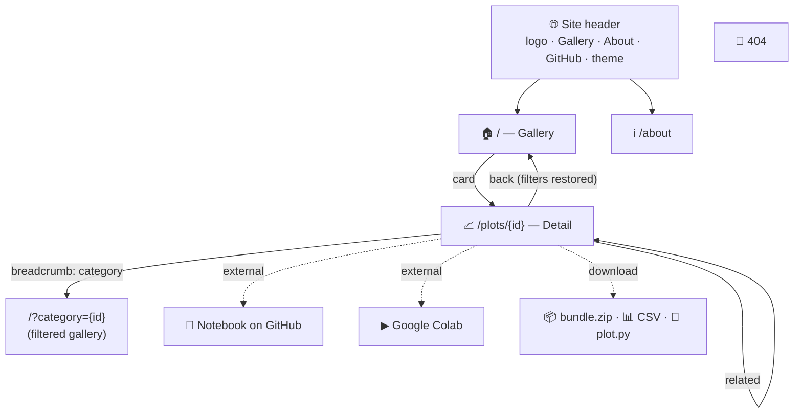
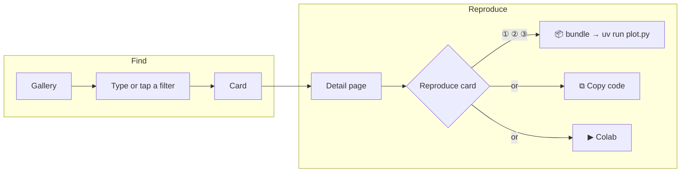
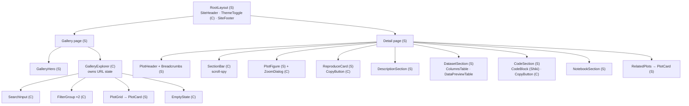

# 04 — UI/UX Specification

> Status: Approved v1.0 · Last updated: 2026-10-18 · Index: [README](README.md) · Visual summary: [00](00-overview.md)

## 1. Design direction

**Concept: "the specimen cabinet".** Each plot is presented like a carefully mounted specimen: a paper-like canvas, precise labels, and metadata set in monospace like catalog tags. The interface steps back so the figures stand out.

**UX north star:** *from "I need a chart" to "I have it running" in under a minute.* Every page has **one obvious primary action**:

| Page | Primary action | Everything else |
|------|----------------|-----------------|
| Gallery | Find a plot (search box) | Filters, cards |
| Detail | Reproduce the plot ("Reproduce this plot" card) | Reading, dataset, code, notebook |

| Principle | In practice |
|-----------|-------------|
| **The figure comes first** | Figures get the largest area and the calmest surroundings |
| **One thing per place** | Every task has a single home: reproduce → the card; inspect data → the Dataset section; read code → the Code section. No duplicated buttons. |
| **Same pattern everywhere** | The same section bar, card and chips on every screen size |
| **Precise, not decorative** | Monospace labels, hairline borders, a strict spacing grid; no gradients on surfaces, no illustrations |
| **One accent** | A single teal from the *viridis* colormap, used only for interactive elements and focus |
| **Calm in both themes** | Dark mode is designed, not inverted |

**Signature details**

- A 2 px *viridis* hairline (purple → teal → yellow) at the very top of the header. It is the only gradient.
- A faint dot grid (graph paper) behind the gallery hero.
- Figure "plates": a canvas with an inner border and a monospace label underneath (`PLOT-ID · LIBRARY · DATASET`).
- **Category glyphs**: every category has a small chart icon, used on chips, cards and the breadcrumb.

## 2. Information architecture



### 2.1 The two main flows



## 3. Category glyphs

| Category | Label | lucide icon | Dot color (light / dark) |
|----------|-------|-------------|--------------------------|
| `distribution` | Distribution | `chart-column` | `#3B528B` / `#7C93D6` |
| `comparison` | Comparison | `chart-bar` | `#2C728E` / `#5FB3D3` |
| `relationship` | Relationship | `chart-scatter` | `#1A7F7A` / `#3CC4B4` |
| `composition` | Composition | `chart-pie` | `#3E8A4F` / `#72C484` |
| `time-series` | Time series | `chart-line` | `#7A7A1F` / `#C9C95A` |
| `statistical` | Statistical | `sigma` | `#5B4F9A` / `#A89AE0` |
| `machine-learning` | Machine learning | `brain-circuit` | `#8A4F7D` / `#D296C4` |

The glyph is always paired with the label, so color and icon are never the only signal.

## 4. Pages

### 4.1 Gallery (`/`)

```text
┌──────────────────────────────────────────────────────────────────────┐
│▔▔▔▔▔▔▔▔▔▔▔▔▔▔▔▔▔▔▔▔ viridis hairline ▔▔▔▔▔▔▔▔▔▔▔▔▔▔▔▔▔▔▔▔▔▔▔▔▔▔▔▔▔▔▔▔│
│ ◰ Plot Gallery              Gallery  About             [GitHub] [◐]  │
├──────────────────────────────────────────────────────────────────────┤
│ · · · · · · · · · · · · · · · (dot grid) · · · · · · · · · · · · · · │
│        Reproducible Python visualizations                            │
│        Every plot ships with its code, data and notebook.            │
│   ┌────────────────────────────────────────────────────────────┐     │
│   │ 🔍  Search plots, libraries, datasets…                [ / ] │     │
│   └────────────────────────────────────────────────────────────┘     │
│        3 plots · 2 libraries · 1 dataset                             │
├──────────────────────────────────────────────────────────────────────┤
│ CATEGORY  (▥ Distribution 2) (▤ Comparison 1) (⁘ Relationship 1) …   │
│ LIBRARY   (Matplotlib 1) (Seaborn 2)                                 │
│                                       3 plots · Clear filters ✕      │
├──────────────────────────────────────────────────────────────────────┤
│ ┌────────────────┐  ┌────────────────┐  ┌────────────────┐           │
│ │ ┌────────────┐ │  │ ┌────────────┐ │  │ ┌────────────┐ │           │
│ │ │ thumbnail  │ │  │ │            │ │  │ │            │ │           │
│ │ │ 4:3 canvas │ │  │ │            │ │  │ │            │ │           │
│ │ └────────────┘ │  │ └────────────┘ │  │ └────────────┘ │           │
│ │ ⁘ SCATTER PLOT │  │ ▤ BOX PLOT     │  │ ▥ HISTOGRAM    │           │
│ │ Penguin bill   │  │ Penguin body   │  │ Penguin flipper│           │
│ │ dimensions…    │  │ mass by…       │  │ length         │           │
│ │ Two-line       │  │ …              │  │ …              │           │
│ │ summary…       │  │                │  │                │           │
│ │ seaborn · Beg. │  │ seaborn · Beg. │  │ matplotlib·Beg.│           │
│ └────────────────┘  └────────────────┘  └────────────────┘           │
├──────────────────────────────────────────────────────────────────────┤
│ Footer: MIT · CC BY 4.0 · GitHub · Datasets credited on each page    │
└──────────────────────────────────────────────────────────────────────┘
```

**Card anatomy** (top to bottom): thumbnail on a canvas (4:3) → eyebrow with glyph + chart type (mono, uppercase) → title (2 lines max) → summary (2 lines max) → footer row with the primary library and difficulty. The whole card is one link.

Behavior:

- Live filtering as the user types. `/` focuses the search and `Esc` clears it.
- Filter chips are toggle buttons (`aria-pressed`) with live counts. Chips with zero matches are disabled, not hidden.
- The URL is the state (`?q=&category=&library=`), updated with `router.replace`.
- The result count is announced in a polite live region.
- Empty state: "No plots match …", with **Clear filters** and **Clear search** buttons.

### 4.2 Plot detail (`/plots/[id]`)

Desktop (≥ 1024 px): main content in 8 columns, the **Reproduce card** in 4 columns (sticky).

```text
┌──────────────────────────────────────────────────────────────────────┐
│ ◰ Plot Gallery              Gallery  About             [GitHub] [◐]  │
├──────────────────────────────────────────────────────────────────────┤
│ Gallery / ⁘ Relationship / Penguin bill dimensions by species        │
│ ⁘ SCATTER PLOT                                                       │
│ Penguin bill dimensions by species                              (H1) │
│ Bill length against bill depth for three penguin species, revealing… │
│ (⁘ Relationship)  (seaborn)  (Beginner)                              │
├──────────────────────────────────────────────────────────────────────┤
│ ▸Visualization   Description   Dataset   Code   Notebook   (sticky)  │
├────────────────────────────────────────────────┬─────────────────────┤
│ ┌────────────────────────────────────────────┐ │ REPRODUCE THIS PLOT │
│ │                                            │ │                     │
│ │               FIGURE (canvas)              │ │ ① Download bundle   │
│ │                                         ⤢  │ │   [⤓ .zip · 24 KB]  │
│ │                                            │ │                     │
│ └────────────────────────────────────────────┘ │ ② Unzip it and open │
│ SCATTER-PENGUIN-BILL-DIMENSIONS · SEABORN ·    │   a terminal there  │
│ PALMER-PENGUINS                                │                     │
│                                                │ ③ Run               │
│ Description                                    │   $ uv run plot.py ⧉│
│ What it shows ……                               │   No uv? Install ↗  │
│ ┌ When to use ────────┐ ┌ Applications ──────┐ │ ─────── or ──────── │
│ │ • …                 │ │ • …                │ │ [⧉ Copy code]       │
│ └─────────────────────┘ └────────────────────┘ │ [▶ Open in Colab]   │
│ ⚠ Watch out for: …                             │ ─────────────────── │
│                                                │ Library  seaborn    │
│ Dataset · Palmer Penguins                      │ Dataset  Palmer P.  │
│ 344 rows · 8 columns · 13 KB · CC0-1.0         │ License  CC0-1.0    │
│ Columns ◆ = used by this plot                  │ Updated  2026-10-18 │
│ Preview (10 rows, scrolls horizontally)        └─────────────────────┘
│ [⤓ Download CSV]  Source ↗  Cite ▾             │
│                                                │
│ Python code                                    │
│ ┌ plot.py ──────────────── [⤓] [⧉ Copy] ┐      │
│ │  1 # /// script                       │      │
│ │  …                                    │      │
│ └───────────────────────────────────────┘      │
│ Pinned: matplotlib 3.10.7 · pandas 2.3.3 · …   │
│                                                │
│ Notebook                                       │
│ ①Import → ②Load → ③Prepare → ④Draft → ⑤Style → ⑥Final
│ [↗ View on GitHub]  [▶ Open in Colab]          │
├────────────────────────────────────────────────┴─────────────────────┤
│ Related plots   [card] [card] [card]                                 │
└──────────────────────────────────────────────────────────────────────┘
```

Mobile (< 1024 px), single column, in this order: header block → section bar (sticky, horizontally scrollable) → figure → **Reproduce card** → Description → Dataset → Code → Notebook → Related.

| Section | Details |
|---------|---------|
| **Header block** | Breadcrumb (category crumb links to `/?category=<id>`), eyebrow, H1, summary, badges. No action buttons, since actions live in the Reproduce card. |
| **Section bar** | Sticky under the site header. Scroll-spy highlights the current section; a click scrolls smoothly to it (instantly with reduced motion). Same component on all screen sizes. |
| **Visualization** | `<figure>` with `` (800w, 1600w), explicit `width`/`height`, `fetchpriority="high"`. Enlarge (⤢ or a click on the image) opens a Dialog showing the PNG at native size. The `<figcaption>` holds the plate label. |
| **Reproduce card** | Numbered steps: ① bundle download (with size), ② unzip and open a terminal, ③ `uv run plot.py` with a copy button and an "Install uv" link. Then "or": **Copy code** and **Open in Colab**. Then the key facts as a `<dl>`. Sticky on desktop. |
| **Description** | "What it shows" paragraph. "When to use" and "Applications" as two bordered lists side by side (≥ 768 px). "Watch out for" in a subtle note box. |
| **Dataset** | Stat line. **Columns** table (name · type · unit · description), with ◆ and a highlight on the required columns. **Preview** table (10 rows; required columns tinted; `NA` in muted text; right-aligned tabular numbers; sticky header; scrolls inside its container). Download CSV, source link, a "Cite" disclosure with copyable text. |
| **Python code** | A code block with a filename tab, line numbers (not copied), Shiki dual theme, copy and download buttons. The full code is always shown. Pinned dependency chips below it. |
| **Notebook** | The six-step stepper (horizontal on desktop, vertical on mobile), "View on GitHub" (primary) and "Open in Colab" (secondary), both marked as external. |
| **Related** | Up to 3 standard cards. |

### 4.3 About (`/about`) — Should

A single prose column (max 68 characters per line):

1. **What this is**: one paragraph.
2. **How it works**: a compact version of the four-worlds diagram from [00](00-overview.md#3-the-repository-in-four-worlds), rendered as an inline SVG.
3. **The reproducibility promise**: the contract in plain words.
4. **Run any plot locally**: the same 3 steps as the Reproduce card.
5. **Contribute**, **Licenses**, **Dataset credits**.

### 4.4 404

A centered `404 · PLOT NOT FOUND` in mono, one line of text, a "Back to the gallery" button, and the standard header and footer.

## 5. Components

`(S)` = Server Component, `(C)` = Client Component. Client components are kept to the minimum needed.



| Component | Type | Responsibility |
|-----------|------|----------------|
| `SiteHeader`, `SiteFooter` | S | Global chrome, skip link |
| `ThemeToggle` | C | System/Light/Dark menu |
| `CategoryBadge` | S | Glyph + label (+ dot color) |
| `GalleryHero` | S | Title, tagline, search slot, stats |
| `GalleryExplorer` | C | URL state; composes search, filters, count, grid, empty state; uses the pure `filterPlots()` |
| `SearchInput` | C | Icon, `/` hint, clear button |
| `FilterGroup` | C | Labeled group of toggle chips with counts |
| `PlotGrid`, `PlotCard` | S | Responsive grid; card anatomy as in §4.1 |
| `EmptyState` | C | Message and reset actions |
| `Breadcrumbs`, `PlotHeader` | S | Title block |
| `SectionBar` | C | Sticky section links and scroll-spy (IntersectionObserver) |
| `PlotFigure` + `ZoomDialog` | S + C | Figure, plate label, enlarge |
| `ReproduceCard` | S (+ C buttons) | The 3 steps, alternatives, key facts |
| `DescriptionSection` | S | |
| `DatasetSection`, `ColumnsTable`, `DataPreviewTable` | S | |
| `CodeSection`, `CodeBlock` | S | Shiki HTML, filename tab, line numbers |
| `CopyButton` | C | Clipboard with fallback; "Copied" for 2 s; `aria-live` |
| `CommandSnippet` | S | `$ uv run plot.py` with a CopyButton |
| `NotebookSection` | S | Stepper and external links |
| `RelatedPlots` | S | |
| shadcn primitives | — | `Button`, `Badge`, `Input`, `Dialog`, `DropdownMenu`, `Tooltip`, `Separator` |

## 6. Visual system

### 6.1 Color tokens

CSS variables on `:root` and `.dark` (OKLCH in code; hex here for readability), mapped to Tailwind v4 tokens.

| Token | Light | Dark | Use |
|-------|-------|------|-----|
| `--background` | `#FBFBFA` | `#0E1013` | Page |
| `--surface` | `#FFFFFF` | `#16191E` | Cards, panels, Reproduce card |
| `--surface-muted` | `#F3F4F2` | `#1D2127` | Table headers, code background, hover |
| `--border` | `#E4E5E2` | `#2A2F37` | Hairlines |
| `--foreground` | `#16181D` | `#E9EBEE` | Text |
| `--muted-foreground` | `#5C6370` | `#9AA3AF` | Secondary text (≥ 4.5:1) |
| `--accent` | `#1A7F7A` | `#3CC4B4` | Links, active chips, focus ring, step numbers |
| `--accent-foreground` | `#FFFFFF` | `#08201E` | Text on the accent |
| `--canvas` | `#FFFFFF` | `#F4F4F1` | **Figure background in both themes** (D-07) |
| `--canvas-border` | `#E4E5E2` | `#3A404A` | Figure frame |
| `--highlight` | `#FDF6D8` | `#3A3416` | Required columns in the tables |
| `--destructive` | `#B42318` | `#F97066` | Errors (rare) |

**Figures in dark mode:** they sit on `--canvas` (a slightly dimmed off-white) with 16 px padding and a 1 px `--canvas-border`, so they read as mounted prints. The image itself is never altered, so it always matches what `plot.py` produces.

### 6.2 Typography

| Role | Font | Size / line-height | Weight |
|------|------|--------------------|--------|
| Display (hero) | Geist Sans | 40/44 (mobile 30/36), −0.02em | 600 |
| H1 (detail) | Geist Sans | 32/38 (mobile 26/32) | 600 |
| H2 (section) | Geist Sans | 22/28 | 600 |
| H3 | Geist Sans | 17/24 | 600 |
| Body | Geist Sans | 16/26 | 400 |
| Small | Geist Sans | 14/20 | 400 |
| Label / eyebrow / plate | Geist Mono | 12/16, uppercase, +0.06em | 500 |
| Code | Geist Mono | 14/22 (mobile 13/20), no ligatures | 400 |

Prose is capped at 68 characters per line; table numbers use `tabular-nums`.

### 6.3 Spacing, shape, elevation

- **Spacing (4 px base):** 4, 8, 12, 16, 24, 32, 48, 64, 96. Detail section gap: 64 px (mobile 48).
- **Container:** max 1280 px; padding 16 / 24 / 32 px (mobile / tablet / desktop).
- **Radius:** controls 6 px, cards and panels 10 px, code 8 px, chips fully rounded.
- **Elevation:** flat, defined by borders. Card hover: border at 40% accent + `translateY(-2px)` + a soft shadow (light mode only). No motion with `prefers-reduced-motion`.
- **Icons:** lucide, 16/20 px, stroke 1.75.

### 6.4 Code theme

Shiki dual themes (`github-light` / `github-dark-dimmed` as a base, tuned to the tokens), switched through CSS variables with no re-render. Code background `--surface-muted`.

## 7. Responsive design

| Breakpoint | Width | Gallery grid | Detail layout | Filters |
|------------|-------|--------------|---------------|---------|
| base | < 640 | 1 column | Single column; Reproduce card after the figure | One horizontally scrollable chip row per group |
| `sm` | ≥ 640 | 2 columns | Single column | Wrapped chips |
| `lg` | ≥ 1024 | 3 columns | 8 + 4 columns; sticky Reproduce card | Wrapped chips |
| `2xl` | ≥ 1536 | 4 columns | Same, container capped at 1280 px | Wrapped chips |

Rules: touch targets ≥ 44×44 px; tables and code scroll inside their containers; no horizontal page scroll; no hover-only information.

## 8. Interactions and states

| Interaction | Behavior | Feedback |
|-------------|----------|----------|
| Type in search | Instant filter; `q` in the URL | Count updates (live region) |
| Toggle a chip | OR within a group, AND across groups | `aria-pressed`, accent fill |
| Clear filters | Resets the chips (the search is kept, unless "Clear all") | Grid restored |
| Click a card | Navigate; store the gallery URL in `sessionStorage` for "back" | Prefetch on viewport |
| Download bundle / CSV / `plot.py` | `<a download>` | Native |
| Copy command / code / citation | Clipboard API (with a fallback) | ✓ "Copied" for 2 s; `aria-live`; on error, the text is selected with the hint "Press Ctrl+C" |
| Enlarge figure | Dialog; `Esc` or the backdrop closes it; focus is trapped and restored | 150 ms fade/scale (none with reduced motion) |
| Section bar | Smooth scroll; scroll-spy | Active item underlined in the accent |
| Theme | System/Light/Dark, persisted | Icon reflects the mode |

States to design: empty (no results), error (clipboard), focus (2 px accent ring, 2 px offset), disabled (zero-count chips at 40% opacity, `aria-disabled`).

## 9. Accessibility (WCAG 2.2 AA)

- Landmarks, one H1 per page, strict heading order, skip link.
- The detail figure's `alt` comes from the required `image.alt`. Card thumbnails use `alt=""` because the card's title already names them.
- Fully keyboard-operable with a visible focus. Dialogs trap and restore focus (Radix).
- Contrast ≥ 4.5:1 (text) and ≥ 3:1 (UI, focus) in both themes, verified in P4.
- Tables use `<th scope>`, a caption, and a focusable labeled region when they scroll.
- External links are announced as opening in a new tab. Icon-only buttons have `aria-label`.
- `prefers-reduced-motion` is respected.
- Authoring rule (reviewed): colorblind-safe palettes, direct labels where possible, no meaning carried by color alone.

## 10. Microcopy

- Sentence case everywhere ("Download bundle", not "Download Bundle").
- Buttons start with a verb: *Download bundle*, *Copy code*, *Open in Colab*, *View on GitHub*.
- Library names in lowercase in code contexts (`seaborn`) and capitalized in filters ("Seaborn").
- Titles tell the data story ("Penguin bill dimensions by species"); `chart_type` names the chart.
- Step texts in the Reproduce card are at most 6 words each.

## 11. SEO and sharing

- `<title>`: `{Title} · {Chart type} in Python · Plot Gallery`.
- Meta description = `summary`; Open Graph and Twitter image = `plot-800.webp`.
- `sitemap.xml` (`/`, `/about`, every plot), `robots.txt`.
- JSON-LD `SoftwareSourceCode` on detail pages (Should).
