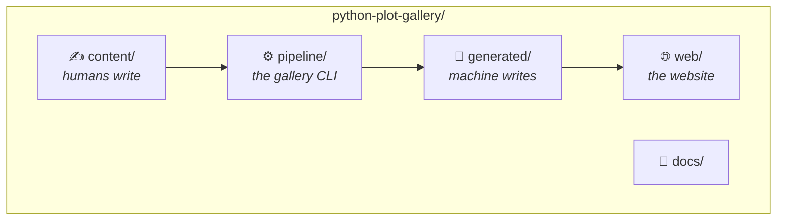
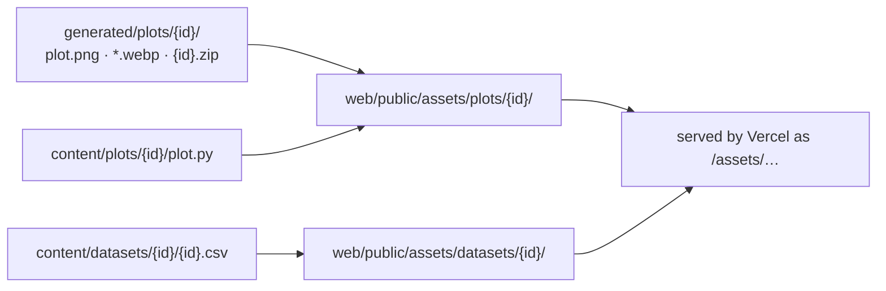

# 05 — Project Structure

> Status: Approved v1.0 · Last updated: 2026-10-18 · Index: [README](README.md) · Visual summary: [00](00-overview.md)

## 1. The four worlds



**The rule that keeps it understandable:** to add or change a plot you touch **only `content/`**, run `uv run gallery update`, and commit what changed in `content/` and `generated/`.

| World | Question it answers | You edit it when… |
|-------|---------------------|-------------------|
| ✍️ `content/` | *What does the gallery publish?* | Adding or changing plots and datasets |
| ⚙️ `pipeline/` | *How is content validated and turned into artifacts?* | Changing the rules or the tooling |
| 🤖 `generated/` | *What did the pipeline produce?* | **Never**: `gallery update` writes it |
| 🌐 `web/` | *How is it shown?* | Changing the site's design or behavior |
| 📘 `docs/` | *Why and how?* | Changing specs or guides |

Each world has a `README.md` of about 10 lines (purpose · what lives here · what you may edit · the key command), so the repository explains itself on GitHub.

## 2. Repository layout

```text
python-plot-gallery/
│
├── content/                              ✍️ WHAT HUMANS WRITE
│   ├── README.md
│   ├── datasets/
│   │   └── palmer-penguins/
│   │       ├── dataset.yaml              metadata: source, license, columns, checksum
│   │       └── palmer-penguins.csv       the data (≤ 5 MB)
│   └── plots/
│       ├── scatter-penguin-bill-dimensions/
│       │   ├── plot.yaml                 metadata: title, description, categories, dataset…
│       │   ├── plot.py                   the canonical code   (🤖 PEP 723 header)
│       │   └── notebook.ipynb            the 6-step lesson    (🤖 data/final cells + outputs)
│       ├── box-penguin-body-mass/
│       │   └── …same three files
│       └── histogram-penguin-flipper-length/
│           └── …same three files
│
├── pipeline/                             ⚙️ THE GALLERY CLI (Python package)
│   ├── README.md
│   ├── plot_gallery/
│   │   ├── __init__.py
│   │   ├── cli.py                        argparse entry point → `gallery …`
│   │   ├── config.py                     reads [tool.gallery]; all paths in one place
│   │   ├── models.py                     Pydantic models + category/library labels and icons
│   │   ├── loader.py                     discover folders, parse YAML, collect errors
│   │   ├── datasets.py                   checksum, column/type checks, preview, stats
│   │   ├── script.py                     AST rules, library detection, PEP 723 sync
│   │   ├── render.py                     sandbox + savefig + WebP thumbnails
│   │   ├── _harness.py                   code that runs inside the sandbox
│   │   ├── compare.py                    image comparison + diff images
│   │   ├── notebooks.py                  structure, cell sync, execution, cleanup
│   │   ├── bundle.py                     deterministic zip bundles
│   │   ├── catalog.py                    catalog build, schema export, drift check
│   │   └── scaffold.py                   `gallery new`
│   ├── templates/
│   │   ├── plot/                         plot.yaml · plot.py · notebook.ipynb
│   │   ├── data_cell.py.tmpl             notebook data cell
│   │   └── bundle_readme.md.tmpl         README inside each zip
│   └── tests/
│       ├── conftest.py
│       ├── fixtures/                     tiny valid and *must-fail* plots and datasets
│       └── test_*.py                     one test module per pipeline module
│
├── generated/                            🤖 WHAT THE MACHINE WRITES — never edit
│   ├── README.md                         "Do not edit. Regenerate with: uv run gallery update"
│   ├── catalog.json                      the only file the website reads
│   ├── schemas/
│   │   ├── plot.schema.json              → YAML autocompletion
│   │   ├── dataset.schema.json
│   │   └── catalog.schema.json           → web/src/types/catalog.ts
│   └── plots/
│       └── scatter-penguin-bill-dimensions/
│           ├── plot.png                  1600×1200 reference image
│           ├── plot-1600.webp
│           ├── plot-800.webp
│           └── scatter-penguin-bill-dimensions.zip   the reproduction bundle
│
├── web/                                  🌐 THE WEBSITE (Next.js · Vercel root)
│   ├── README.md
│   ├── src/
│   │   ├── app/                          routes (thin: compose components)
│   │   │   ├── layout.tsx                fonts, theme, header, footer
│   │   │   ├── page.tsx                  /            gallery
│   │   │   ├── plots/[id]/page.tsx       /plots/{id}  detail
│   │   │   ├── about/page.tsx            /about
│   │   │   ├── not-found.tsx             404
│   │   │   ├── sitemap.ts · robots.ts
│   │   │   └── globals.css               Tailwind + design tokens
│   │   ├── components/
│   │   │   ├── ui/                       shadcn primitives (owned code)
│   │   │   ├── layout/                   site-header · site-footer · theme-toggle · breadcrumbs · category-badge
│   │   │   ├── gallery/                  gallery-hero · gallery-explorer · search-input · filter-group
│   │   │   │                             plot-grid · plot-card · empty-state
│   │   │   └── plot/                     plot-header · section-bar · plot-figure · zoom-dialog
│   │   │                                 reproduce-card · description-section · dataset-section
│   │   │                                 columns-table · data-preview-table · code-section · code-block
│   │   │                                 copy-button · command-snippet · notebook-section · related-plots
│   │   ├── lib/                          logic, no JSX
│   │   │   ├── catalog.ts                reads ../generated/catalog.json (server-only)
│   │   │   ├── search.ts                 pure: normalize · filterPlots · facetCounts · URL state
│   │   │   ├── urls.ts                   GitHub / Colab / raw / uv links from catalog.repository
│   │   │   ├── highlight.ts              Shiki (build time)
│   │   │   ├── site-config.ts            site name, NEXT_PUBLIC_SITE_URL
│   │   │   └── utils.ts                  cn()
│   │   └── types/
│   │       └── catalog.ts                🤖 generated from catalog.schema.json (npm run gen:types)
│   ├── scripts/
│   │   └── sync-assets.mjs               copies images, bundles, plot.py, CSV → public/assets/
│   ├── public/
│   │   ├── favicon.svg
│   │   └── assets/                       🤖 copied at dev/build time — gitignored
│   ├── tests/
│   │   ├── unit/                         Vitest
│   │   └── e2e/                          Playwright + axe
│   ├── next.config.ts                    output: 'export', images.unoptimized, trailingSlash
│   ├── vercel.json                       headers + caching
│   ├── package.json · package-lock.json
│   ├── tsconfig.json · eslint.config.mjs · components.json
│   └── vitest.config.ts · playwright.config.ts
│
├── docs/                                 📘 WHY AND HOW
│   ├── specs/                            these documents (00–06)
│   └── authoring-guide.md                how to add a plot, step by step
│
├── .github/
│   ├── workflows/
│   │   ├── content.yml                   Python: lint, tests, gallery check
│   │   └── web.yml                       site: types, lint, tests, build, e2e
│   ├── dependabot.yml                    (P7) uv, npm, github-actions
│   ├── ISSUE_TEMPLATE/new-plot.yml
│   └── pull_request_template.md
│
├── pyproject.toml                        uv project + [tool.gallery] + ruff + pytest
├── uv.lock
├── .python-version                       3.12
├── .editorconfig · .gitattributes · .gitignore
├── README.md                             what it is, the 4 worlds, quick start
├── CONTRIBUTING.md
├── LICENSE                               MIT (code)
└── LICENSE-CONTENT                       CC BY 4.0 (text and images)
```

## 3. Responsibilities and rules

| Path | Owns | Rules |
|------|------|-------|
| `content/datasets/<id>/` | One dataset version | Exactly `dataset.yaml` + `<id>.csv`. ≤ 5 MB. |
| `content/plots/<id>/` | One plot's sources | Exactly `plot.yaml`, `plot.py`, `notebook.ipynb`. Any other file fails validation. |
| `pipeline/plot_gallery/` | Validation and generation | No frontend knowledge beyond the catalog contract. Pure functions where possible; I/O at the edges (`cli.py`, `loader.py`). |
| `pipeline/templates/` | Starting points | A scaffolded plot, once filled in, passes `gallery check` (tested). |
| `pipeline/tests/` | Pipeline tests | Use `fixtures/` only, never real content. |
| `generated/` | Every pipeline output | Written only by `gallery`. CI fails on drift. |
| `web/src/app/` | Routes | Thin. Data comes from `lib/catalog.ts`. |
| `web/src/components/` | Presentation | Data comes through props. `'use client'` only where interaction needs it. |
| `web/src/lib/` | Logic and data access | Framework-agnostic, unit-tested. |
| `web/src/types/catalog.ts` | Frontend types | Generated; drift-checked in `web.yml`. |
| `web/public/assets/` | Downloadable/static copies | Created by `sync-assets`, gitignored. |

### What gets copied where (`sync-assets`)



## 4. Python project configuration (outline)

```toml
[project]
name = "python-plot-gallery"
version = "0.1.0"
requires-python = ">=3.12,<3.13"
dependencies = [
  # plotting libraries used by content
  "matplotlib", "seaborn", "numpy", "pandas",
  # pipeline
  "pydantic>=2", "pyyaml", "nbformat", "nbclient", "ipykernel", "pillow",
]

[project.scripts]
gallery = "plot_gallery.cli:main"

[dependency-groups]
dev = ["pytest", "ruff"]
notebooks = ["jupyterlab"]

[build-system]
requires = ["uv_build"]
build-backend = "uv_build"

[tool.uv.build-backend]
module-root = "pipeline"          # the package lives in pipeline/plot_gallery
module-name = "plot_gallery"

[tool.gallery]
repo_owner = "neisserale"
repo_name = "python-plot-gallery"
repo_branch = "main"
dpi = 200
figure_size = [8, 6]
image_tolerance = 2.0
render_timeout_s = 60
cell_timeout_s = 120
max_dataset_mb = 5

[tool.pytest.ini_options]
testpaths = ["pipeline/tests"]

[tool.ruff]
line-length = 100
target-version = "py312"

[tool.ruff.format]
quote-style = "single"

[tool.ruff.lint]
select = ["E", "F", "I", "B", "UP", "SIM", "N"]
```

Version ranges are fixed in P1; `uv.lock` holds the exact pins.

## 5. Everyday commands

| I want to… | Command |
|------------|---------|
| Set up the project | `uv sync` (add `--group notebooks` to edit notebooks) |
| Create a new plot | `uv run gallery new <plot-id>` |
| Edit a notebook | `uv run --group notebooks jupyter lab` |
| Regenerate after editing | `uv run gallery update <plot-id>` |
| Verify everything (= CI) | `uv run gallery check` (use `--skip-notebooks` for speed) |
| Run the Python tests and lint | `uv run pytest` · `uv run ruff check` · `uv run ruff format` |
| See the site | `cd web && npm install && npm run dev` |
| Regenerate the TS types after a schema change | `cd web && npm run gen:types` |

Frontend scripts: `predev`/`prebuild` → `sync-assets`; `dev`, `build` (→ `out/`); `lint`; `typecheck`; `gen:types`; `test`; `test:e2e`.

## 6. Naming conventions

| Item | Convention | Example |
|------|------------|---------|
| Plot id / folder | kebab-case `<chart-type>-<subject>` | `box-penguin-body-mass` |
| Dataset id / folder | kebab-case `<subject>[-vN]` | `palmer-penguins` |
| Dataset file | `<dataset-id>.csv` | `palmer-penguins.csv` |
| Files in a plot folder | Fixed: `plot.yaml`, `plot.py`, `notebook.ipynb` | — |
| Bundle | `<plot-id>.zip` with the folder `<plot-id>/` inside | `box-penguin-body-mass.zip` |
| YAML / JSON keys | snake_case | `required_columns` |
| Python modules / functions / variables | snake_case, English | `render_plot()` |
| Python classes / constants | PascalCase / UPPER_SNAKE | `PlotMetadata` / `DATA_PATH` |
| TS / React files | kebab-case | `reproduce-card.tsx` |
| React components | PascalCase | `ReproduceCard` |
| TS functions / variables | camelCase | `filterPlots` |
| CSS tokens | `--kebab-case` | `--muted-foreground` |
| Branches | `type/short-description` | `feat/box-plot` |
| Commits | Conventional Commits | `feat(content): add box plot of penguin body mass` |

## 7. Code style

**Python**

- English names and comments (D-01, D-02). Standard `# ` comments, kept short, explaining *why*.
- Single quotes for short strings, triple double quotes for docstrings (enforced by Ruff).
- Type hints on public functions; docstrings on every module and public function.
- No classes where a function is enough. Pydantic models are the only class hierarchy.

**TypeScript / React**

- `strict`, no `any`; props types next to the component.
- Server Components by default; `'use client'` only where needed.
- Data access only through `lib/catalog.ts`.
- Tailwind utilities and tokens only, with no hard-coded hex colors.
