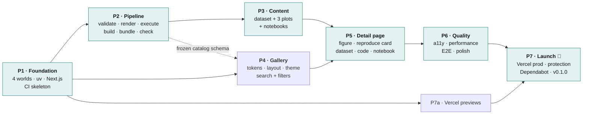
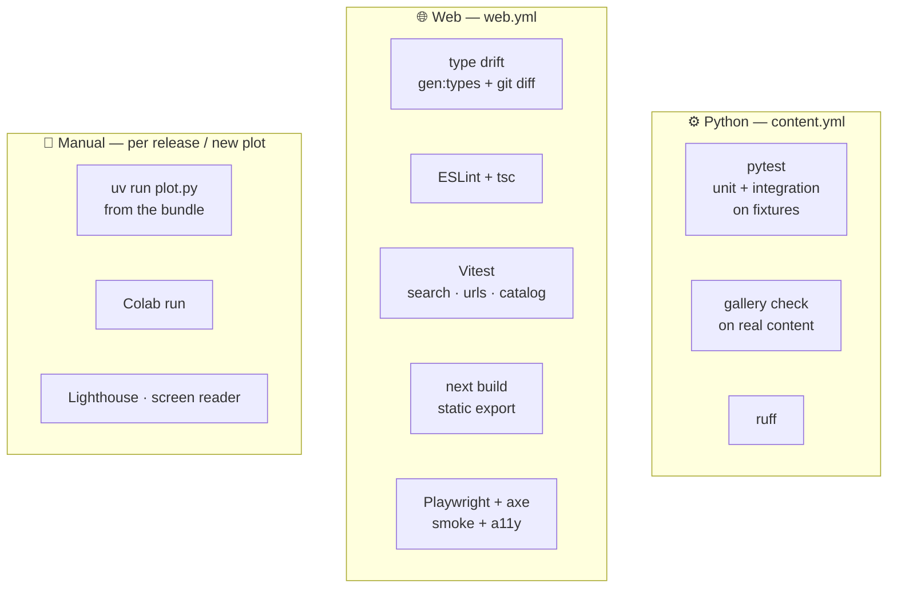

# 06 — Implementation Plan

> Status: Approved v1.0 · Last updated: 2026-10-18 · Index: [README](README.md) · Visual summary: [00](00-overview.md)

## 1. Strategy

- **Contract first.** The Python → web contract (`generated/catalog.json` and its schema) is frozen in P2. From then on, the frontend is built against a fixture catalog, in parallel with the content.
- **Vertical slice early.** One plot goes end to end (content → catalog → page) before the other two are produced.
- **Every phase ends green.** Each phase merges to `main` through PRs with CI passing and has explicit exit criteria.
- **Phases are units of review.** The result of each phase is reviewed before the next starts.

## 2. Roadmap

| Phase | Goal | Depends on | Size |
|-------|------|------------|------|
| P1 | The repository's four worlds, Python and web skeletons, CI skeleton | — | S |
| P2 | The complete content pipeline with its tests | P1 | L |
| P3 | Dataset + 3 plots + notebooks + authoring guide | P2 | M |
| P4 | Design system, layout, theme, gallery page | P1 (+ the P2 schema) | M |
| P5 | Detail page | P3, P4 | M |
| P6 | Accessibility, performance, E2E, polish | P5 | M |
| P7 | Production deployment and launch | P6 (P7a after P1) | S |

## 3. Phases in detail

### P1 — Foundation

| Task | Description |
|------|-------------|
| P1-1 | Create the worlds: `content/`, `pipeline/`, `generated/`, `web/`, `docs/`, each with its short `README.md` |
| P1-2 | `pyproject.toml` (uv, `uv_build` with `module-root = "pipeline"`, groups, `[tool.gallery]`, Ruff, pytest), `.python-version`, `uv.lock`; `pipeline/plot_gallery` with `gallery --help` |
| P1-3 | `web/`: Next.js (App Router, TS strict, Tailwind v4, ESLint), `output: 'export'`, shadcn init, Geist fonts, placeholder page |
| P1-4 | `.gitignore` (incl. `web/public/assets/`, `.gallery/`), `.gitattributes`, `.editorconfig`, `LICENSE`, `LICENSE-CONTENT`, root `README.md`, draft `CONTRIBUTING.md` |
| P1-5 | CI: `content.yml` (ruff + pytest) and `web.yml` (lint + typecheck + build) |

**Exit criteria**

- `uv sync --locked && uv run gallery --help` works on Windows and in CI.
- `npm ci && npm run build` produces `web/out/`.
- Both workflows are green, and the root README shows the four-worlds diagram.

### P2 — Content pipeline

| Task | Description | Depends on |
|------|-------------|------------|
| P2-1 | `models.py`: Pydantic models (Plot, Dataset, Catalog), label and icon maps, JSON Schema export | P1-2 |
| P2-2 | `config.py` + `loader.py`: settings, folder discovery, YAML, `id` = folder, errors reported together | P2-1 |
| P2-3 | `datasets.py`: checksum, header/types/categories/nullability, size, stats, preview | P2-2 |
| P2-4 | `script.py`: AST rules, library detection, PEP 723 read/write from `uv.lock` (`tomllib`) | P2-2 |
| P2-5 | `render.py` + `_harness.py`: sandbox, isolated environment, savefig, WebP, timeout, stray-file detection | P2-4 |
| P2-6 | `compare.py`: tolerance comparison, diffs in `.gallery/diff/` | P2-5 |
| P2-7 | `notebooks.py`: structure validation, `data`/`final` cell sync, nbclient execution, cleanup | P2-4 |
| P2-8 | `bundle.py`: deterministic zip + README from the template | P2-3, P2-4 |
| P2-9 | `catalog.py`: denormalized build with `repository` and facets, deterministic JSON, schema export, drift check | P2-3, P2-4, P2-8 |
| P2-10 | `cli.py`: `sync`, `render`, `execute`, `build`, `update`, `check` (`--skip-notebooks`), exit codes | P2-5…P2-9 |
| P2-11 | `scaffold.py` + `pipeline/templates/plot/` → `gallery new` | P2-10 |
| P2-12 | Fixtures and tests per module, including one *must-fail* fixture per validation rule | Ongoing |
| P2-13 | **Tolerance calibration** on Windows + Ubuntu; set `image_tolerance` | P2-6 |
| P2-14 | `content.yml`: `content` job with `gallery check`; upload diff images on failure | P2-10 |

**Exit criteria**

- `uv run pytest` passes with ≥ 85% coverage of `pipeline/plot_gallery`.
- On the fixture plot, `gallery update` produces images, notebook outputs, the bundle and the catalog. A second run leaves **no git diff** (idempotent).
- `gallery check` catches each of: a changed color, a wrong `DATA_PATH`, a network call, an edited final cell, a modified CSV, an invalid `required_columns` value, a stale catalog or bundle.
- `generated/schemas/catalog.schema.json` is frozen as v1.

### P3 — First content

| Task | Description |
|------|-------------|
| P3-1 | `palmer-penguins` dataset: upstream CSV, license check, `dataset.yaml`, checksum |
| P3-2 | **Vertical slice:** `scatter-penguin-bill-dimensions` (yaml, py, a six-step notebook) → `gallery update` |
| P3-3 | `box-penguin-body-mass` (seaborn, species × sex) |
| P3-4 | `histogram-penguin-flipper-length` (matplotlib + numpy; the bin choice explained in the notebook) |
| P3-5 | `docs/authoring-guide.md`: step-by-step guide with the "life of a plot" diagram, style and palette rules, checklist |
| P3-6 | Manual reproducibility: unzip each bundle and run `uv run plot.py` on Windows and on Linux/macOS (AC-13); run each notebook in Colab (AC-14). Decide whether Colab needs a `%pip install` cell with the pins. |

**Exit criteria**

- `gallery check` is green with the three plots.
- The notebooks render on GitHub with outputs and run in Colab.
- AC-13 and AC-14 are recorded in the PR.
- Palettes and alt text are reviewed.

### P4 — Gallery page and design system

| Task | Description |
|------|-------------|
| P4-1 | Tokens in `globals.css` (light/dark) mapped to Tailwind; contrast check of every pair |
| P4-2 | `layout.tsx`: fonts, ThemeProvider, SiteHeader (viridis hairline), SiteFooter, skip link |
| P4-3 | `lib/catalog.ts` (reads `../generated/catalog.json`), `lib/urls.ts`, `lib/site-config.ts`, `npm run gen:types`, with unit tests |
| P4-4 | `scripts/sync-assets.mjs` (`predev`/`prebuild`) |
| P4-5 | `lib/search.ts`: normalize, AND tokens, facet counts, URL parse/serialize; ≥ 95% coverage |
| P4-6 | `CategoryBadge` with glyphs; GalleryHero, GalleryExplorer (inside `Suspense`), SearchInput, FilterGroup, PlotCard, PlotGrid, EmptyState |
| P4-7 | `not-found.tsx` |

Until P3 is merged, a fixture catalog that validates against the frozen schema is used.

**Exit criteria:** AC-01…AC-05 and AC-24 pass; the layout is correct at 360, 768, 1280 and 1920 px; Vitest is green.

### P5 — Detail page

| Task | Description |
|------|-------------|
| P5-1 | `plots/[id]/page.tsx`: `generateStaticParams`, `dynamicParams = false`, `generateMetadata` |
| P5-2 | PlotHeader, Breadcrumbs, **SectionBar** (sticky, scroll-spy, same component on all sizes) |
| P5-3 | PlotFigure (`srcset`) + ZoomDialog |
| P5-4 | **ReproduceCard**: 3 steps, CommandSnippet, alternatives (Copy code, Colab), key facts; sticky on desktop, after the figure on mobile |
| P5-5 | DescriptionSection |
| P5-6 | DatasetSection, ColumnsTable, DataPreviewTable, cite disclosure, CSV download |
| P5-7 | `lib/highlight.ts` (Shiki) + CodeSection, CodeBlock, CopyButton, dependency chips |
| P5-8 | NotebookSection (stepper, GitHub and Colab links) |
| P5-9 | RelatedPlots |
| P5-10 | `sitemap.ts`, `robots.ts`, About page with the four-worlds diagram |

**Exit criteria**

- AC-10…AC-16 pass.
- The copy payload equals `code.source` byte for byte (unit test).
- The bundle link downloads a zip whose contents match the sources.
- The build contains exactly 3 detail pages, and unknown ids give the 404 page.

### P6 — Quality and hardening

| Task | Description |
|------|-------------|
| P6-1 | Playwright smoke: gallery, search, filters, URL restore, detail, copy, bundle/CSV/`plot.py` downloads return 200, 404, theme |
| P6-2 | axe on `/`, one detail page and `/about`, in both themes |
| P6-3 | Lighthouse ≥ 90 mobile in all four categories; fixes |
| P6-4 | Keyboard-only and screen-reader pass (NVDA; VoiceOver if available) |
| P6-5 | `vercel.json`: CSP, security headers, cache headers |
| P6-6 | Visual polish against [04](04-ui-ux-spec.md); QA on real devices |
| P6-7 | E2E job in `web.yml` |

**Exit criteria:** AC-20…AC-25 pass.

### P7 — Deployment and launch

| Task | Description | When |
|------|-------------|------|
| P7a-1 | Vercel project: root `web`, files outside root included, Node 24, `NEXT_PUBLIC_SITE_URL`; connect GitHub | After P1 |
| P7a-2 | Check that every PR gets a preview URL | After P1 |
| P7-1 | Branch protection on `main` (required: `quality`, `content`, `web`) | P6 |
| P7-2 | Production deploy; check headers, sitemap and Open Graph previews | P6 |
| P7-3 | `dependabot.yml` (uv, npm, github-actions; weekly; grouped) | P6 |
| P7-4 | Final README (screenshot, the four worlds, quick start), CONTRIBUTING, templates | P6 |
| P7-5 | Tag `v0.1.0` + release notes | Last |

**Exit criteria:** AC-26 passes; production is live; a test PR shows a preview, and its merge deploys automatically.

## 4. Testing strategy

| Layer | What | Tool | Where |
|-------|------|------|-------|
| Python unit | Models, loader, dataset checks, AST, PEP 723, bundle and catalog determinism | pytest | `content.yml` · quality |
| Python integration | Sandbox render and notebook execution on fixtures, including must-fail fixtures | pytest | `content.yml` · quality |
| **Content verification** | Every real plot: schemas, references, checksums, sync, image comparison, notebooks, drift of `generated/` | `gallery check` | `content.yml` · content |
| Lint / format | Python and TypeScript | ruff, ESLint, `tsc` | both |
| Contract | Regenerated types equal the committed ones; the fixture catalog validates against the schema | `gen:types` + `git diff`; ajv in Vitest | `web.yml` |
| Frontend unit | `search.ts`, `urls.ts`, `catalog.ts`, copy payload | Vitest | `web.yml` |
| Build | Static export; expected routes in `out/` | `next build` + an assertion script | `web.yml` |
| E2E + accessibility | Critical flows; axe | Playwright + @axe-core/playwright | `web.yml` |
| Manual | Bundle run on two operating systems, Colab, Lighthouse, screen reader | Human | P3, P6, PR checklist for every new plot |

**Rule:** pipeline tests use `pipeline/tests/fixtures/` only; real content is verified by `gallery check`.

## 5. Deployment checklist

- [ ] Public GitHub repo with a description and topics (`python`, `data-visualization`, `matplotlib`, `seaborn`, `reproducibility`); license detected.
- [ ] Vercel: root `web`, files outside root included, Node 24, `NEXT_PUBLIC_SITE_URL`.
- [ ] PR previews on; production branch `main`.
- [ ] Branch protection with the required checks.
- [ ] `vercel.json` headers verified.
- [ ] `sitemap.xml` and `robots.txt` reachable; canonical URLs use the production domain.
- [ ] Open Graph images render in a link-preview checker.
- [ ] GitHub and Colab links point to `main` and work from production.
- [ ] Bundle, CSV and `plot.py` downloads work; the CSV checksum matches.

## 6. Risks and mitigations

| Risk | Impact | Likelihood | Mitigation |
|------|--------|------------|------------|
| Cross-OS rendering differences | CI flakiness | Medium | Bundled fonts, isolated `MPLCONFIGDIR`, calibrated tolerance (P2-13), diff artifacts |
| Vercel cannot read `../generated` and `../content` | Broken build | Low | "Include files outside root" enabled; fallback: root = repo with `cd web && npm run build` |
| `uv_build` with `module-root = "pipeline"` misbehaves | Setup friction | Low | Verified in P1-2; fallback: `pipeline/src/plot_gallery` (the default layout) |
| Static export limits | Rework | Low | Already designed around: WebP from Python, Suspense, `vercel.json` headers |
| Notebook outputs and bundles grow the repo | Slower clones | Low | Small figures, stripped metadata, ~20 KB zips; review if the repo exceeds 200 MB |
| Dataset license misread | Legal | Low | Allowed SPDX list; review per dataset |
| Library upgrades change many images | Noisy PRs | Medium | Grouped Dependabot PRs; diff artifacts |
| Colab's preinstalled versions differ from the pins | The Colab figure differs slightly | Medium | Tested versions stated in the notebook intro; optional `%pip install` cell (decided in P3-6) |
| Scope creep before the MVP | Delay | Medium | Strict MVP scope ([01 §7](01-product-requirements.md#7-mvp-scope)) |

## 7. Post-MVP backlog (ordered)

1. More plots across all seven categories; second and third datasets.
2. Interactive Plotly plots (`render.kind: interactive`).
3. Dark variants of plot images.
4. Category landing pages and JSON-LD.
5. A "Which chart should I use?" guide: a visual decision tree that leads to the plots.
6. A "Compare" view (side-by-side alternatives).
7. Privacy-friendly analytics (opt-in).
8. Contributor experience: an interactive `gallery new`, and a PR bot comment with before/after images.
