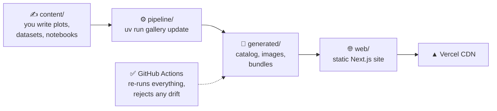

# Plot Gallery — Specifications

> **Status:** Approved v1.0
> **Last updated:** 2026-10-18
> **Method:** Spec-Driven Development (SDD). Implementation follows these documents phase by phase. Changes to an approved spec go through a pull request.

Plot Gallery is an open-source catalog of Python data visualizations in which **every plot is reproducible** from its published code, dataset and notebook.

**New here? Start with [00 — The System at a Glance](00-overview.md).** It explains the whole product with diagrams.

## Documents

| # | Document | Answers the question |
|---|----------|----------------------|
| 00 | [The System at a Glance](00-overview.md) | **What are we building, end to end? (visual)** |
| 01 | [Product Requirements](01-product-requirements.md) | *What* are we building, for whom, and how do we know it is done? |
| 02 | [Technical Architecture](02-technical-architecture.md) | *How* is the system built, deployed and kept reproducible? |
| 03 | [Data Model](03-data-model.md) | *What* does a plot, dataset, bundle and catalog look like, and how is each validated? |
| 04 | [UI/UX Specification](04-ui-ux-spec.md) | *How* does the product look, feel and behave? |
| 05 | [Project Structure](05-project-structure.md) | *Where* does each file live, and what are the naming rules? |
| 06 | [Implementation Plan](06-implementation-plan.md) | *In which order* do we build it, and how do we test and ship each phase? |

> **Viewing diagrams:** GitHub renders Mermaid natively. In VS Code or Cursor, install *Markdown Preview Mermaid Support* (`bierner.markdown-mermaid`) and open the preview with `Ctrl+Shift+V`.

## The idea in brief

1. **You write** three files per plot in `content/plots/<plot-id>/`: `plot.yaml`, `plot.py` and `notebook.ipynb`. Datasets are written once in `content/datasets/`.
2. **The pipeline** (`uv run gallery update`) validates them, renders the image in an isolated sandbox, runs the notebook, and compiles the catalog and a downloadable bundle.
3. **Everything the machine produces** goes into `generated/`, which is committed and never edited by hand.
4. **CI** regenerates everything on each pull request and blocks the merge if anything differs.
5. **The website** reads `generated/catalog.json` at build time and is served by Vercel as static files. No Python runs per visit.

## Glossary

| Term | Meaning |
|------|---------|
| **Plot** | One published visualization: metadata + code + notebook + rendered image. Identified by a `plot-id`. |
| **Dataset** | A versioned data file with its metadata (source, license, columns, checksum). Identified by a `dataset-id`. |
| **Canonical script** | `plot.py`, the single source of truth for the final figure. It is what the site shows and what CI executes. |
| **Final cell** | The notebook code cell tagged `final`. It is generated from `plot.py`. |
| **Bundle** | `<plot-id>.zip`, which contains `plot.py`, the CSV, the notebook and a README: everything needed to reproduce the plot offline. |
| **Catalog** | `generated/catalog.json`: the compiled, validated view of all content, and the only thing the website reads. |
| **Sandbox** | A temporary empty folder containing only `plot.py` and its CSV, where the code is run to prove it is self-contained. |
| **Drift** | A difference between the committed `generated/` files and what the pipeline produces. CI treats it as a failure. |
| **Reproducibility contract** | The rules in [02 §6.1](02-technical-architecture.md#61-the-reproducibility-contract) that every plot must satisfy. |

## Decision log (approved 2026-10-18)

| ID | Decision | Chosen |
|----|----------|--------|
| D-01 | Comments in published code (`plot.py`, notebooks) | English, standard `# ` comments |
| D-02 | Comments in internal tooling (`pipeline/`) | English |
| D-03 | Single source of truth | `plot.py` is canonical; the notebook's final cell is generated from it; notebook steps 1–5 are written by hand |
| D-04 | Generated artifacts | Committed in `generated/` and checked for drift in CI |
| D-05 | Hosting mode | Next.js static export (`output: 'export'`) on Vercel |
| D-06 | Plotly / interactive charts | Left out of the MVP; reserved in the schema (`render.kind`) |
| D-07 | Plot images in dark mode | Light figures on a light "canvas" in both themes |
| D-08 | MVP dataset | Palmer Penguins (CC0-1.0) for the three plots |
| D-09 | Frontend package manager | npm |
| D-10 | Licensing | MIT (code), CC BY 4.0 (text and images); each dataset keeps its own license |
| D-11 | E2E tests in the MVP | Yes: a Playwright smoke test + an axe accessibility check |
| D-12 | Name, owner, domain | "Plot Gallery", `github.com/neisserale/python-plot-gallery`, default `*.vercel.app` |

## Changes in v1.0 (from draft v0.1)

| Area | Change | Why |
|------|--------|-----|
| Docs | New **[00 — The System at a Glance](00-overview.md)** with diagrams of the services, data flow, CI and the user journey | Understand the system end to end at a glance |
| Repository | Reorganized into **four worlds**: `content/` (human), `pipeline/` (tool), `generated/` (machine), `web/` (site) | Each folder has one role, so it is obvious what to edit |
| Repository | **All generated files in one folder**, `generated/` (catalog, schemas, images, bundles), instead of three places | One rule: never edit `generated/` |
| Repository | The tooling moved from `src/`, `tests/` and `templates/` at the root to `pipeline/` | The root no longer mixes tooling and content |
| Repository | Each world gets a short `README.md` ("what is this folder, what can I edit") | Self-explanatory navigation on GitHub |
| Config | `gallery.toml` was replaced by `[tool.gallery]` in `pyproject.toml`; the repo coordinates go into the catalog | One less file and one less environment variable; GitHub and Colab links come from one source |
| Product | **Reproduction bundle** (`<plot-id>.zip`) per plot | Reproducing becomes 3 steps: download → unzip → `uv run plot.py` |
| UX | The detail page has a **"Reproduce this plot" card** that replaces the quick-actions row and the "At a glance" panel | One clear place for the main task, and less clutter |
| UX | A single **horizontal sticky section bar** on all screen sizes, instead of a side TOC on desktop and tabs on mobile | One pattern to learn |
| UX | **Category icons** on chips and cards | Faster visual scanning |

## Change process

- These documents are versioned with the code. A change to an approved spec goes through a PR that updates the affected document(s), its header date and the "Changes" table above.
- Implementation starts with Phase 1 of [06](06-implementation-plan.md).
